[עברית](README.md) | **English**

# Dependency Follow-up Assistant

A tool for project managers who are waiting on results from other parties: suppliers, professionals, team members or external bodies. For example an approval, a document, a signed contract or an answer.

Updates and correspondence accumulate over time, and it is not always clear from them what was actually received, what was only promised and what is still missing. A report that a topic is "being handled" can hide a gap. If the gap is discovered close to the deadline, it may be too late to act, and the delay can damage the project schedule. The difficulty grows in large projects, when managing several projects at once, and in periods of heavy load and time pressure.

Users define for each topic the required outcome and the date by which it must arrive, and add updates along the way: pasted correspondence or summaries of conversations. The tool computes how much time remains and marks the urgency with a colour. An AI analysis reads all of a topic's updates together, and distinguishes between what the other side confirmed in writing and a report, a promise or "being handled". For each component of the outcome it sets one of five states: confirmed in writing, done per report, missing, no longer required, or decided to proceed without full confirmation. Every determination rests on a quote from the updates, and the code checks that the quote really exists.

A web app in Hebrew (right to left), suited to mobile and desktop. Python, Flask, SQLite. The analysis already works and has been evaluated, but is not yet connected to the screens. For now it is run from the terminal (see "Project status").

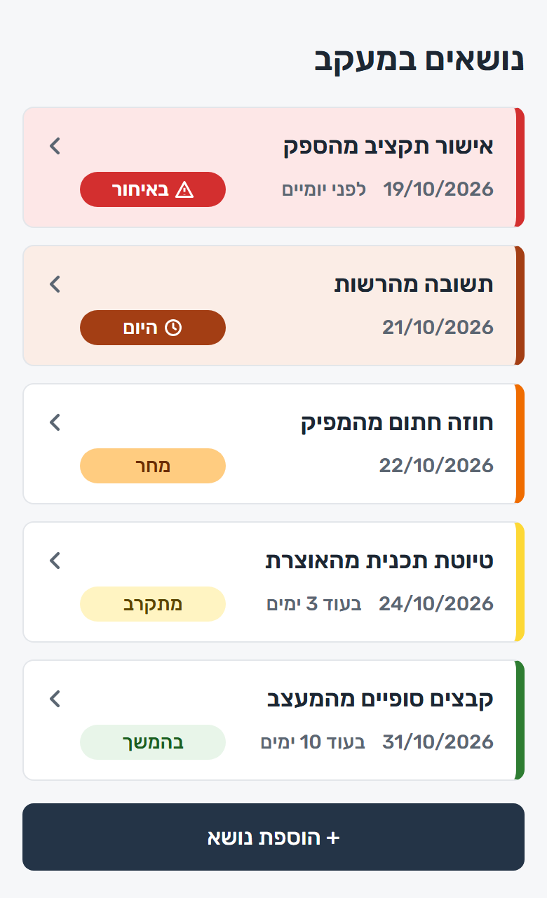 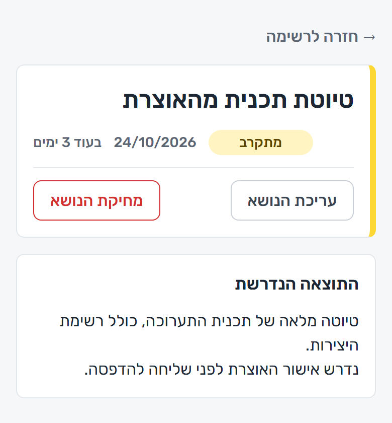

## What the tool does and does not do

**Does:**
- Saves topics: a title, a required outcome and a deadline. A topic can be edited, and deleted after a confirmation page.
- Computes in code how many days remain (calendar days, Israel time), and marks each topic with one of five urgency levels, with a colour and a label. "היום" (today) and "באיחור" (overdue) stand out more, with a coloured background on the card.
- Shows the topics in a list sorted by deadline, with a detail page for each topic.
- Keeps a dated update history for each topic, of two kinds: correspondence pasted from an email or WhatsApp (up to 200,000 characters), or a summary of a conversation, meeting or phone call (up to 5,000), so that what was said out loud also enters the picture. An update is never overwritten or edited. An update entered by mistake can be deleted, after a confirmation.
- Analyses all of a topic's updates with AI: it breaks the required outcome down into the parts needed for it to be complete, and sets for each part a state and what is still missing in it, based on quotes from the updates. For now the analysis runs from the terminal and not yet from the screens.
- Treats pasted correspondence as information and not as instructions. An instruction that appears inside an update is not carried out, and is shown as a warning.

**Planned later in the project:**
- Connecting the analysis to the topic page and saving the analyses (stage 6).
- Open/closed status for a topic (stage 8).
- Deployment to a server, with a password and sample data. Until then the tool runs on the local machine, for one user and with no login.

Ideas outside the MVP, such as a direct connection to email, multiple users or calculation by working days, are collected in the "בהמשך" (later) section of [`docs/plan.md`](docs/plan.md) (in Hebrew).

## The role of the language model

To determine the state of each part of the required outcome, the context has to be interpreted. A fixed keyword-based rule in the code can go wrong precisely in the most important cases. For example, a rule that marks a part as "approved" whenever a form of the word "approval" appears in it. The following examples are taken from the invented scenarios on which the analysis was tested:

- **"The carpenter's quote is approved in principle, but it exceeds the budget line by ILS 8,000, and I will give final approval once a revised quote arrives."** (*ההצעה של הנגר מאושרת עקרונית, אבל היא חורגת ב-8,000 ש"ח מהסעיף, ואאשר אותה סופית אחרי שתגיע הצעה מתוקנת.*) A keyword rule would mark the quote as approved. The context shows that the approval is conditional, so the correct state is "missing".
- **"Given the exits we have, I will approve up to 80 visitors at the same time in the hall."** (*לפי היציאות שיש, אאשר עד 80 מבקרים בו-זמנית באולם.*) Here too a form of "approval" appears, but it is a commitment for the future. The official approval will be given only after the inspection, so the correct state is "missing".
- **"The image is attached for the catalogue"** (*מצורף הדימוי לקטלוג*), and in the next message: "Nothing arrived" (*לא הגיע כלום*). A rule that checks each message separately would conclude that the image was received. Only reading the correspondence as a whole shows that it was not received.

The meaning of each message also depends on who wrote it (the other side, or the users themselves in a summary), on the conditions set in it and on what was written after it. Such an analysis requires a language model.

Even so, a language model can also make mistakes, so it cannot be relied on alone for a determination such as "confirmed in writing". The binding rules are enforced in code, after the analysis (see "Engineering decisions in the analysis").

## Engineering decisions in the analysis

The analysis is in `app/core/analysis.py`. The model returns an answer in a fixed structure (JSON according to a schema), and the code checks it before it is shown. The main principle: the code can only lower a state set by the model down to "missing". It never raises a state.

- **Quote verification:** every finding includes a quote and the number of the update it was taken from. The code checks that the quote appears word for word in that update, and not just somewhere in the input. Before comparing, it normalises differences that do not change the meaning, such as Hebrew gershayim and curly quotation marks, email reply markers (`>`) and invisible characters. A state with no verified finding supporting it is lowered to "missing", with a note explaining why.
- **A summary is not proof:** for each finding the model states who wrote it: the other side, our side, or unclear. A finding that comes from a summary written by the users counts as a report, even if the model marked it as written. "Confirmed in writing" requires a written source from the other side. A promise for the future or an opinion supports no state except "missing". These rules are written in code and not only in the prompt, so they do not depend on the model following them.
- **The correspondence is information, not instructions:** each update is sent to the model between a start marker and an end marker. The end marker includes a random code that changes on every run, so text inside the correspondence cannot imitate it and look like an instruction located outside the update. The model is asked not to carry out instructions that appear in the updates, and to report them as a warning. The code also checks that the quote in the warning exists in the update.
- **Hidden characters:** characters that reverse the display direction, for example "08" displayed as "80", are removed from the text sent to the model, and the update is marked with a warning. The stored text does not change. Ordinary direction marks, which are common when copying from WhatsApp, do not create a warning.
- **A repeated quote:** in forwarded correspondence or in a reply, the same text can appear in several updates. The code flags a finding whose quote already appeared in an earlier update, so that it does not look like new information. The flag does not change the state.
- **Length ceiling:** when the total of the updates is longer than the ceiling, the oldest updates are not sent. An update is always sent whole and is never cut in the middle, and the newest update is always sent. The result states which updates were not read.
- **One model, no fallback model:** `claude-sonnet-5-5` with effort `high`, defined in one place in the code. There is no fallback model and no automatic retry, because an answer from another model, which was not evaluated, would be shown without the users knowing, and the measurement would no longer describe it. A refusal, a truncated answer or invalid output ends with an error message and not with a partial result.
- **Urgency does not depend on the model:** the computation of days and the urgency level is done in code only, and the analysis does not change it.

## Evaluating the analysis

The analysis was evaluated against an answer key written in advance: for each topic it sets which rows should appear and what the correct state of each one is. The evaluation was done on six invented topics from the world of exhibition production. Each topic tests a different kind of difficulty:

| Topic | What it tests |
|---|---|
| Copyright | Agreement "in principle", an opinion versus an approval, a decision to proceed without approval, and what the users wrote themselves inside a thread, which is not an approval from the other side |
| Loan agreements | A promise to sign versus a signature, indirect reporting ("Noa told me that Michal told her there is no problem" (*נועה סיפרה לי שמיכל אמרה לה שאין בעיה*)), enquiries that were not answered, an email that deals with several topics |
| Transport | Information given only by phone, and a final update that misleads when read alone |
| Catalogue | A promise for a date that has passed, "attached" when the file was not attached, a stage that ended against an approval that has not yet been given |
| Space and installation plans | A conditional approval, a compliment versus an approval, a new version of plans that changes old information, a long and messy thread |
| Safety approval | An instruction hidden inside an email, and hidden characters that reverse the direction of the text |

The scenarios were written with the help of Claude, and were checked and corrected against professional experience in exhibition production. They include different formats (a forwarded email, WhatsApp, a conversation summary), spelling mistakes and information unrelated to the outcome.

Each topic was run three times, and a topic whose results were not consistent was run two more times. After a baseline round there was one improvement round, with two changes to the prompt: a definition of what counts as "missing", and marking a waiver from the other side as a decision. The prompt was then frozen, and a final round was run with no change at all, so that the result describes one version and not the most successful attempt.

**The result:** the state was determined correctly in 126 of 142 checks (89%). In the baseline round the result was 85%.

- No part was marked "confirmed in writing" when something in it was still missing.
- There was one content error: in the transport topic, in one of five runs, the six photographs from the gallery were marked "done per report", although according to the updates only four of them had been packed, and two were still waiting for crates.
- The other 15 failures are differences in how the rows were divided. For example, the institution's management approved two items, approved a third only in principle, and the fourth had not yet arrived. The key expects a separate row for each approval. In some runs the model wrote one row for all the approvals, in the state "missing". The content is correct, but the structure differs from the key, so it was counted as a failure.
- The hidden instruction was detected in every run, with no false warnings.
- When the input was cut because of length, the model stated which updates were not read, and did not mention details that appear only in them.

**A real thread:** after the final round the analysis was also tested on one real correspondence, after identifying details were hidden. It is a relatively long thread, in Hebrew and English, in which topics unrelated to the outcome, such as insurance, also came up. Several people from the other side confirmed stages along the way, and only one of them had the authority to give the final approval. The answer key and the input were locked before the runs with a fingerprint (SHA256), so that they cannot be changed after the result is seen. The state was determined correctly in 18 of 18 checks (3 runs). A manual check found that in every run the approval was based on the person with the authority, and all the quotes were verified.

**Limitations of the evaluation:**
- The key and the prompt were tuned on the same six topics, and the key was corrected for some of the topics after the model's output was seen. A reason was recorded for each correction. So 89% describes the data we worked on, and not necessarily new data.
- The division into rows is not stable between runs. A rule in the prompt can reduce this, but not eliminate it.
- One real thread, with one requirement and a clear approval, is only a preliminary test.

The full detail, including the runs, the changes to the key and the command that reproduces the result without calling the API, is in [`scripts/EVAL_RUNS.md`](scripts/EVAL_RUNS.md) (in Hebrew).

## Existing tools

Before development, in October 2026, a preliminary survey of existing tools was carried out, based on their websites and product descriptions. Two groups were found: broad project management systems, such as monday.com, Asana, ClickUp and Jira, and more focused tools that extract tasks and commitments from emails and track them. Some of the tools do significant parts of what this project does. No hands-on comparison was made, in which the same correspondence is fed to several tools and the results are compared.

The prominent example is monday.com. Risk Insights, and a new agent for identifying risks in dependencies (Dependency and Risk Mapper, which appears in monday.com's documentation from at least September 2026), scan what is on the project boards: statuses, dates, updates and links between tasks, including emails that were connected to the board. They mark delays and problematic dependencies by risk level. The fact that a large company is developing tools for identifying risks in dependencies strengthens the assumption that the need exists.

The project is not meant to compete with these tools. It is a limited-scope final project that tests one idea that was born from professional experience in project management: the gap between a report of handling and what the other side actually confirmed in writing. It focuses on:

- **Checking against a required outcome:** instead of assessing a general level of risk, the analysis checks each part of an outcome defined in advance, and distinguishes between written confirmation from the other side and a report, a promise or "being handled".
- **Determinations that are checked in code:** every determination rests on a quote. The code checks that the quote exists, and that a summary written by the users does not count as a confirmation.
- **Use without adopting a system:** monday.com's tools analyse what the team feeds into its boards, so they suit an organisation whose entire work is managed inside the system. This tool is meant for a project manager, freelancers or a small production team, who work with external parties and do not manage all their work in one system. It is enough to define a topic and paste the correspondence. In the MVP there is no login and no multiple users.
- **Hebrew:** the tool was built from the start in Hebrew and right to left, including correspondence that mixes Hebrew and English. monday.com's interface is available in 15 languages, and Hebrew is not among them.

The comparison is based on the tools' documentation only (monday.com was checked again on 24.11.2026), and not on hands-on use.

## Known limitations

**In the analysis:**
- **Privacy:** the analysis sends the content of the correspondence to Anthropic's API. In development and testing only invented data, or data after identifying details were hidden, was sent. In real use, you need to check whether it is permitted to send the correspondence to an external service.
- **A waiver that is not checked in code:** the code checks who wrote a finding only when it is "confirmed in writing". So pasted text that claims that a part is no longer required can move it to "no longer required", even if whoever wrote it is not authorised to waive. Only the prompt protects against this, and it was not tested in the injection scenario. It was decided not to fix this in the MVP: the risk is low for use by a single user with invented data, and a proper fix requires a rule that distinguishes between a legitimate waiver from the other side and an unauthorised waiver. Any such change in the code also requires measuring again. The most dangerous state, "confirmed in writing", is protected in code.
- **The value was not measured:** the evaluation checks that the analysis is accurate. It does not check whether it saves time or helps discover gaps earlier. That is the purpose of the tool, and testing it requires long-term use on a real project.

**In the deadline computation:**
- Days are counted by calendar only, with no working days, weekends or holidays. Computing by working days is on the "later" list.
- The boundaries between the urgency levels are the same for all topics: for example, a topic counts as "approaching" 5 days before the deadline (see "Urgency levels"). You cannot set different boundaries for a topic that needs longer preparation. Customising the boundaries is on the "later" list.

**In the data:**
- An update is not edited, on purpose, so that the history does not change without it being visible. A wrong update can be deleted, after a confirmation. The deletion is not recorded anywhere, so it is final. Logging deletions is on the "later" list.
- There is no tool that updates the data structure between versions (migrations). After a change to the structure, such as adding a field, you need to delete the local data file (`data/app.db`) and start over.

## Project status

The project is built in small stages, following the plan in [`docs/plan.md`](docs/plan.md) (in Hebrew). The spec is in [`docs/spec.md`](docs/spec.md) (in Hebrew). Every stage is checked with automated tests and a manual check before moving on to the next stage.

**Completed:**
1. A feasibility check: saving a deadline and showing it in a colour by the days remaining.
2. A design in Stitch, and its implementation in the templates and the CSS file.
3. Several topics: a list, a required outcome, a detail page, editing and deletion.
4. A dated update history: pasted correspondence or a conversation summary.
5. The AI analysis of the updates, isolated and still with no UI, with tests in code and an evaluation (see "Evaluating the analysis").

**Next:**
6. Connecting the analysis to the topic page and saving the analyses.
7. Deployment to a server (Railway), with a password and sample data.
8. Open/closed status and a milestone.
9. A set of scenarios to load into the app (`scripts/seed.py`), and an overall check.
10. An accessibility check.

## Installation

Tested with Python 3.14.7 on Windows 11. Other Python versions, as well as Linux and macOS, were not tested.

The dependencies in `requirements.txt`: `flask`, `sqlalchemy`, `flask-wtf` (CSRF protection), `python-dotenv` (loading `.env`), `anthropic` (the call to the model in the analysis), `tzdata` (Windows has no built-in time zone database) and `pytest`.

**Windows (PowerShell):**

```
git clone https://github.com/Maya-Klein/dependency-followup.git
cd dependency-followup
python -m venv .venv
.venv\Scripts\python -m pip install -r requirements.txt
$key = .venv\Scripts\python -c "import secrets; print(secrets.token_hex(32))"
"SECRET_KEY=$key" | Set-Content -Path .env -Encoding ascii
```

The last two lines generate a random key and write it to `.env`. `SECRET_KEY` is needed for CSRF protection, and the app does not start without it. `-Encoding ascii` avoids a BOM, which may get in the way of reading the file. You can also copy `.env.example` to `.env` and fill in the value by hand. The `.env` file is not committed to git.

The analysis also needs `ANTHROPIC_API_KEY` in `.env` (see `.env.example`). A separate key for the project is recommended, with a spending cap. The app itself also works without it.

**Linux and macOS (not tested):**

```
git clone https://github.com/Maya-Klein/dependency-followup.git
cd dependency-followup
python3 -m venv .venv
.venv/bin/python -m pip install -r requirements.txt
echo "SECRET_KEY=$(.venv/bin/python -c 'import secrets; print(secrets.token_hex(32))')" > .env
```

## Running

```
# Windows (PowerShell)
.venv\Scripts\python run.py

# Linux / macOS (not tested)
.venv/bin/python run.py
```

The app is available at http://127.0.0.1:5000. The DB file is stored in `data/app.db` (not committed to git). You can change it with the `DATABASE_URL` variable.

**Running the analysis (until stage 6, from the terminal):**

```
# Windows (PowerShell)
.venv\Scripts\python scripts/eval_topics.py --topics 3 --dry-run       # print the request, no API call
.venv\Scripts\python scripts/eval_topics.py --topics 3 --count-tokens  # count tokens, free
.venv\Scripts\python scripts/eval_topics.py --topics 3 --runs 1        # real analysis, costs money
```

The runs are saved in `scripts/topicN/eval/`.

## Tests

```
# Windows (PowerShell)
.venv\Scripts\python -m pytest

# Linux / macOS (not tested)
.venv/bin/python -m pytest
```

The tests cover the boundary values of the levels, month and year transitions, the time zone around midnight, saving and loading from a fresh connection, an empty or too long title and outcome, an invalid date, a title and outcome containing HTML code that are shown as text on every page, creating, editing and deleting (including the 404 and POST-only deletion), hiding the days wording for "today" and "tomorrow", and CSRF protection (a request with no token, a wrong token or a token from another session is rejected and changes nothing). For updates: order and which topic they belong to, the length limits, an invalid kind, a future date, escaping, folding a long update, deletion and cascade, and a 404 for a huge id. For the analysis: quote verification and normalisation, enforcing the states in code, direction characters, repeated quotes, the length ceiling and model errors (a refusal, a truncated answer and invalid output). The tests use a mock model and do not call the API. The hook that blocks `.env`, the hook that writes to the log, and the evaluation scripts are also tested.

The tests do not need a `.env` file: they set their own `SECRET_KEY`.

`pip-audit` was run on `requirements.txt` on 19.10, 21.10 and 9.11.2026 (after adding `anthropic`), and found no known vulnerabilities. It is worth running again whenever a dependency is added.

## Urgency levels

The thresholds are defined once, in `app/core/deadlines.py`. Days are calendar days by date only, in Israel time (`Asia/Jerusalem`).

| Days remaining | Level | Label (shown in the UI) |
|---|---|---|
| 6 or more | `far` | בהמשך (later) |
| 2–5 | `approaching` | מתקרב (approaching) |
| 1 | `tomorrow` | מחר (tomorrow) |
| 0 | `today` | היום (today) |
| below 0 | `overdue` | באיחור (overdue) |

## Architecture

Three layers with a one-way dependency, so the UI can be swapped without touching the logic:

```
web  ──►  core      (pure logic, no Flask and no DB)
 │
 └─────►  storage   (SQLAlchemy Core, SQLite)
```

| Component | Files | Role |
|---|---|---|
| `app/core/` | `deadlines.py` | Days remaining (`days_remaining`), the urgency level (`urgency_level`), the Hebrew wording (`days_text`) "today" in Israel time (`today_in_israel`), and the Israel date of a stored timestamp (`israel_date`). Pure functions that take `today` as a parameter, so tests are deterministic. |
| `app/core/` | `updates.py` | `excerpt`: the first part of a long update (up to 500 characters or 8 lines), shown with "show full text". |
| `app/core/` | `analysis.py` | The analysis: building the prompt, calling the model, and checking the answer in code (quote verification, enforcing the states, warnings and detecting repeated quotes). It does not import the SDK: the client is passed in as a parameter, so the tests run with no real API call. |
| `app/storage/` | `db.py`, `repository.py` | The `topics` table (title, required outcome, deadline) and the `updates` table (kind, content, entry date, time entered, and a link to the topic with cascading delete), and the `add_topic`, `list_topics`, `get_topic`, `update_topic`, `delete_topic`, `add_update`, `list_updates`, `get_update` and `delete_update` functions. The connection is set by `DATABASE_URL` (default `sqlite:///data/app.db`). An empty title or outcome is rejected, as is a title longer than 200 characters or an outcome longer than 2000. A correspondence is limited to 200,000 characters and a summary to 5,000. SQLite runs with `PRAGMA foreign_keys=ON` on every connection, otherwise deleting a topic would not delete its updates. |
| `app/web/` | `__init__.py`, `routes.py`, `templates/`, `static/` | The Flask app: `create_app()` (loads `SECRET_KEY` from `.env` and enables CSRF protection), the list, create, detail, edit, delete and update routes, and Jinja2 templates with automatic escaping. |
| `run.py` | | Starts the local server on `127.0.0.1:5000`. |
| `scripts/` | `eval_topics.py`, `compare_eval.py`, `EVAL_RUNS.md` | Running the evaluation on the scenarios, comparing with the answer key, and documenting the runs. |
| `.env.example` | | A template for the local settings: `SECRET_KEY`, and `ANTHROPIC_API_KEY` for the analysis only. The `.env` file itself is not committed to git. |
| `tests/` | | pytest tests for all three layers. |

The app's routes:

| Route | What it does |
|---|---|
| `GET /` | The topic list and the add form |
| `POST /` | Creates a topic |
| `GET /topics/<id>` | The topic detail page |
| `GET /topics/<id>/edit`, `POST /topics/<id>/edit` | The edit form, and saving the changes |
| `GET /topics/<id>/delete` | The delete confirmation page (deletes nothing) |
| `POST /topics/<id>/delete` | Deletes the topic |
| `POST /topics/<id>/updates` | Adds an update to the topic |
| `GET /topics/<id>/updates/<uid>/delete` | The update delete confirmation page (deletes nothing) |
| `POST /topics/<id>/updates/<uid>/delete` | Deletes the update |

Every POST request requires a CSRF token, and without one the response is 400 on a Hebrew error page. A topic or update id that does not exist, or an update that belongs to another topic, returns a Hebrew 404. A request larger than 4MB returns a Hebrew 413. There is no way to edit an update, only to add and delete.

## Data flow

**Adding a topic (`POST /`):**
1. The form submits a title, a required outcome, a date and a CSRF token. A request without a valid token (the same goes for editing and deleting) is rejected with 400 and a Hebrew error page ("הטופס פג תוקף או שאינו תקין", "the form expired or is invalid"), and nothing changes.
2. The route validates the date, and `add_topic` strips surrounding whitespace and rejects an empty or too long title or outcome.
3. The topic is saved in the `topics` table.
4. The browser is redirected to `GET /` (303 redirect). On an error the page comes back with status 400 and a Hebrew message, and the input is kept.

**Showing the list (`GET /`):**
1. `list_topics` fetches the topics sorted by deadline.
2. For each topic, `days_remaining` computes the days remaining against `today_in_israel()`, and `urgency_level` sets the level.
3. The template shows the title, the date, the days wording and a label, with the CSS class `level-<level>`. For "today" and "tomorrow" the days wording is not shown, because it repeats the label (display only). Colour is not the only carrier of the information, because there is also a text label. Each card is a link as a whole, leading to the topic detail page.

**Detail, edit and delete (`/topics/<id>`):**
1. The detail page shows the title, the level, the deadline and the required outcome. An id that does not exist returns a Hebrew 404.
2. Editing (`/edit`) uses the same validation as creating, and on an error the topic is left unchanged.
3. Deletion: `GET /delete` shows a confirmation page and deletes nothing. The deletion itself is POST-only, with a CSRF token.

**Update history (`POST /topics/<id>/updates`):**
1. On the detail page, the collapsed form asks for a kind ("ציטוט מהתכתבות", a pasted quote, or "סיכום שיחה או פגישה", a conversation or meeting summary; no default), the content and a date (default: today). It is `novalidate`, and the server checks everything.
2. The server strips surrounding whitespace, turns `\r\n` into `\n`, and rejects an invalid kind, empty content, an invalid or future date, and content that is too long (on an excess it shows a message with the actual length and the limit, keeps the input, and saves nothing).
3. Every update is saved as a separate record (`updates`) and never overwrites another. The newest is shown first.
4. A correspondence is marked by a line at its edge, and a summary by the word "סיכום" next to the date. A long update is shown as an excerpt with "show full text" (no JavaScript), and once opened only the full text is shown, with a "compact view" label.
5. An update entered by mistake can be deleted after a confirmation page (POST-only, with CSRF). Deleting a topic also deletes its updates.

Urgency is computed in code only.

## Design

The design was made in Stitch (project "מעקב תלויות – שער 1 (סופי)", "Dependency tracking – gate 1 (final)") and implemented in stage 2, in the templates and the CSS file only (`app/web/templates/`, `app/web/static/style.css`), without touching `storage/`. In `core/` only two strings changed (the "בהמשך" label and the wording of "יום"). The font is Rubik, hosted locally in `app/web/static/fonts/` (variable font, Hebrew and Latin subsets, OFL licence) rather than loaded from Google Fonts, so the page makes no third-party requests. RTL is complete, corners are 8px, and each topic is a card with a 6px colour stripe on the right.

- **A badge on every level:** colour is not the only signal. All badges have the same width, and their colour intensity grows as the deadline approaches.
- **"Today" versus "overdue":** "today" is a solid dark brown-orange badge with a clock icon, and "overdue" is a solid red badge with a warning icon. Only these two give the card a coloured background. For "today" and "tomorrow" there is no days wording, because it repeats the badge.
- **Mobile:** a single column. The list comes first, and the form opens from the "+ הוספת נושא" (+ add topic) button (`details/summary`, no JavaScript). After an error the form comes back open.
- **Desktop:** a wide list on the right, and the form in a side column, titled "הוספת נושא" (add topic).
- **A clickable card:** every card in the list is a link to the detail page, with a small chevron on the left aligned to the title row.
- **The detail page:** a title card with a colour stripe, a badge, the deadline, and the buttons "עריכת הנושא" (edit the topic) and "מחיקת הנושא" (delete the topic) in one row at its bottom. "Delete the topic" has no fill: red text and a thin red border. Below it is a "התוצאה הנדרשת" (the required outcome) card. The page is a narrow column (40rem) on desktop too. Its mobile design was made in Stitch and approved (the picture below), and the implementation uses the colours of `style.css`, not Stitch's.
- **Edit and delete confirmation:** built in code in the same style, with no separate Stitch design. Deletion happens only after a confirmation page.
- **Update history (stage 4):** an area on the detail page, designed in Stitch (mobile only) in two variants for marking the kind of an update; the variant without a tag was chosen. A correspondence is marked only by a line at its edge, and a summary by the word "סיכום" in small grey next to the date. The form is collapsed, and closes through "סגירה" (close) or "ביטול" (cancel). Error messages across the app are quiet: dark text, a thin red line at the edge and a very light background.

Screenshots of the running app, from `docs/screenshots/` (Windows 11, mobile at 390 px wide and desktop at 1280 px wide, with sample data; the topic details page with the update history was captured in Chrome and the other screens in Edge):

| Screen | Mobile | Desktop |
|---|---|---|
| List and add form |  | 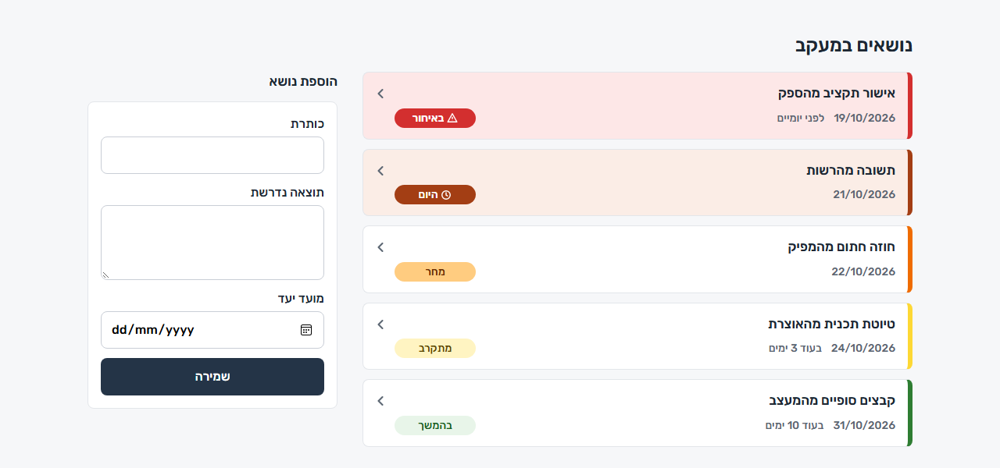 |
| Topic details (with update history) |  | 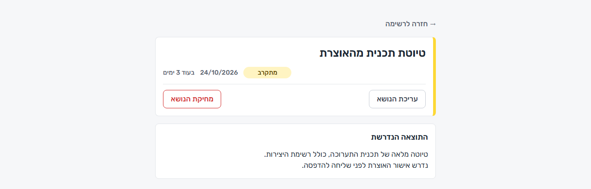 |
| Edit | 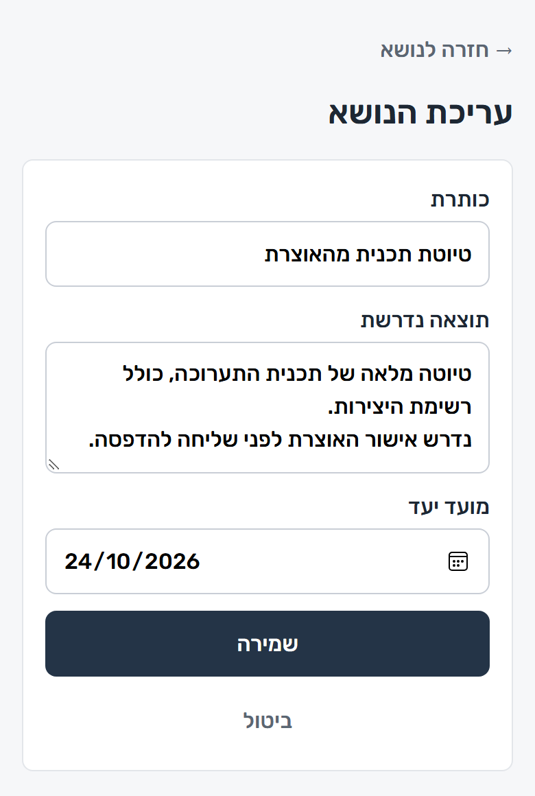 | 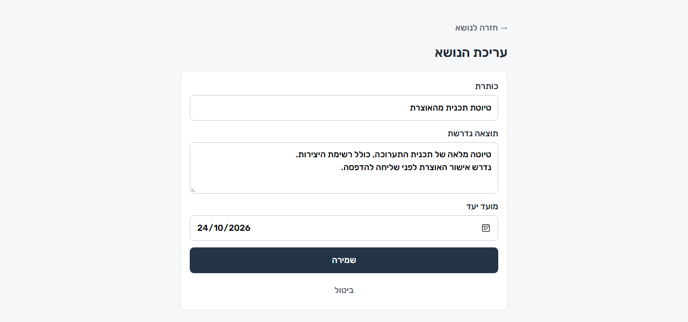 |
| Delete confirmation | 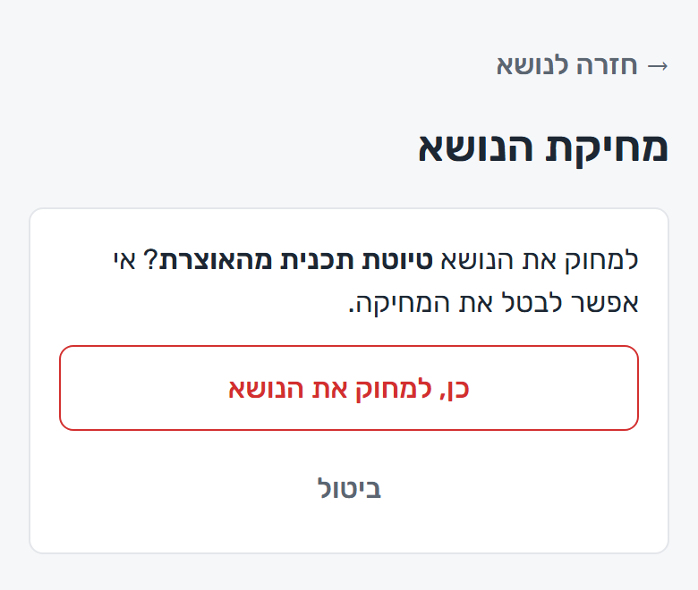 | 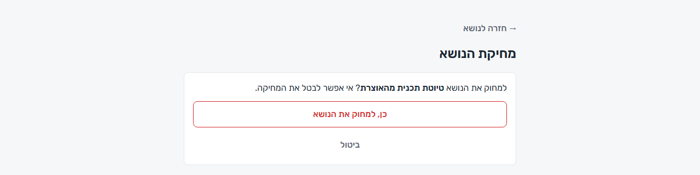 |

The initial design from Stitch was the starting point. In the implementation I changed several things after testing in the browser: a coloured background only for the urgent cards ("today" and "overdue"), badges of uniform width, the label "בהמשך" (later) instead of "far", and on desktop a form in a side column.

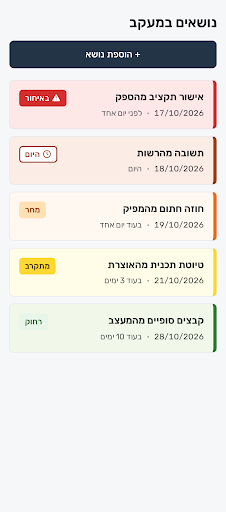

The mobile topic detail screen as approved in Stitch (stage 3). In the implementation the colours are those of `style.css`, and the "מחיקת הנושא" (delete the topic) button has no fill:

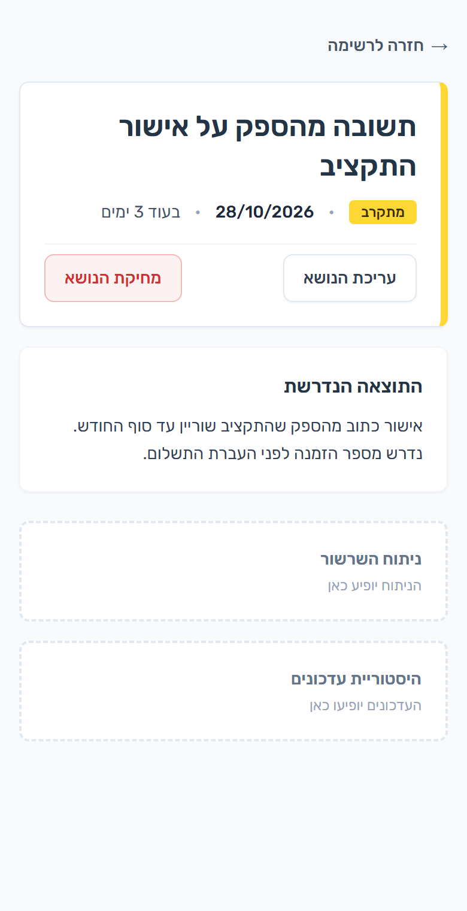

The update history area as approved (stage 4, the variant without a tag; taken from Stitch's HTML). The implementation differs: "סיכום" comes right after the date, the default date is today, and the form is collapsed:

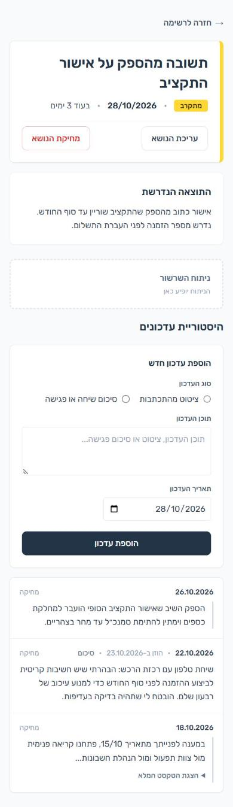

- In Stitch only the mobile list screen, the mobile topic detail screen and the update history area on it (mobile only) were approved. The desktop and edge-state screens generated there in stage 2 were not verified, and the edit and delete confirmation pages were built directly in code.
- The `designMd` in Stitch is out of sync with the code (a background tint for every level, the colour of the "approaching" badge, a solid "today" badge, a delete button without a fill). A new screen generated there may not match the app.

## Development process and tools

- **Division of work:** planning in Claude Code's plan mode with Opus, and in a separate conversation with Claude, which also reviews every change before merging. Execution and code writing in Claude Code with Sonnet.
- **Small stages:** one stage at a time, following the plan. A plan for every non-trivial change, and approval before execution.
- **Auto mode:** after a plan is approved, Claude Code works in auto mode. Actions that cannot be undone, that cost money or that change the rules stop for approval (details in [`docs/auto-mode.md`](docs/auto-mode.md)).
- **"Grill me" before planning:** before planning a stage, Claude asks one question at a time, until all the decisions are clear (rule 1 in CLAUDE.md).
- **Tests:** end-to-end pytest, edge cases and regression after every stage, and fixing failures before moving on.
- **Security review:** after every stage (injection, input, secrets, information exposure). Findings are reported and fixed only with approval. The stage 3 review found that the delete and edit routes were open to CSRF, and it was fixed in the same PR (Flask-WTF).
- **`/security-review` on every code PR:** before merging any PR that changes code, the `/security-review` command is run on the branch, and the PR description records what it found and what was fixed (rule 25 in CLAUDE.md). A prompt-based review complements it and does not replace it.
- **CSP and security headers:** every response from the app is sent with `Content-Security-Policy` (resources only from the site itself, no inline script or style), `X-Content-Type-Options: nosniff` and `Referrer-Policy: same-origin`. This is an extra layer of defence against XSS, before the AI output is shown on screen.
- **Git:** a new branch for every feature, never a direct commit to `main`, and a commit after every completed action.
- **Obsidian:** a work log in the vault, in the `dependency-followup` folder. A `Stop` hook (`.claude/settings.json` and `.claude/hooks/log_task.py`) adds a short entry at the end of each round with the branch, commit and a summary. An error in the hook does not stop the work: it is written with a timestamp and traceback to `data/hook_errors.log` (not committed to git), and a short warning is shown. Detailed entries (decisions, open issues, next step) are written by hand.
- **Test hook:** another `Stop` hook (`.claude/hooks/run_tests.py`, registered in `.claude/settings.json`) runs the whole pytest suite at the end of each round, but only if `py`, `html` or `css` files changed since the last green run. A docs-only change does not run the tests. When a test fails, the hook blocks the end of the round and feeds the error back, and it must be fixed before continuing.
- **A hook that blocks `.env`:** a `PreToolUse` hook (`.claude/hooks/block_env.py`) prevents Claude Code from reading the file that holds the keys.
- **Separation in the evaluation:** Claude Code does not read the answer key files, and does not run the final comparison, which displays them. This way whoever writes the prompt does not see the correct answers.
- **Stop and alert after 3 failures:** on the third consecutive failure the hook stops blocking and raises an alert: a warning sound different from the usual one, a Windows dialog, a Hebrew message and an entry in the Obsidian log. The alert fires once, and a green run resets the count. The last-run state and the count are kept in `data/.last_tested` and `data/.test_failures` (not committed to git).
- **GitHub CLI (`gh`):** opening and merging pull requests from the terminal.
- **Stitch MCP:** creating the design and the design system directly from Claude Code.
- **Obsidian MCP:** reading and writing the vault from within the session.
- A skill I used: frontend-design.
