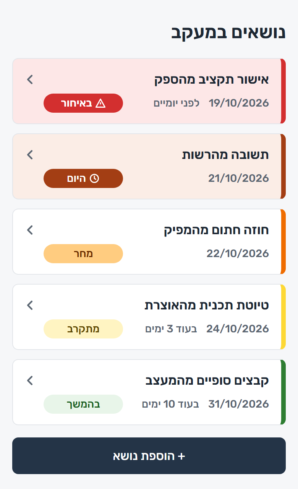
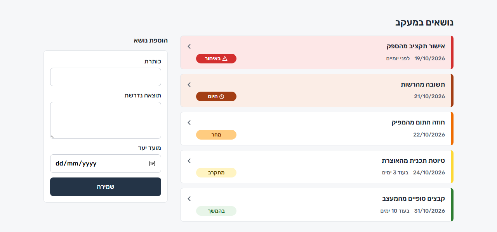
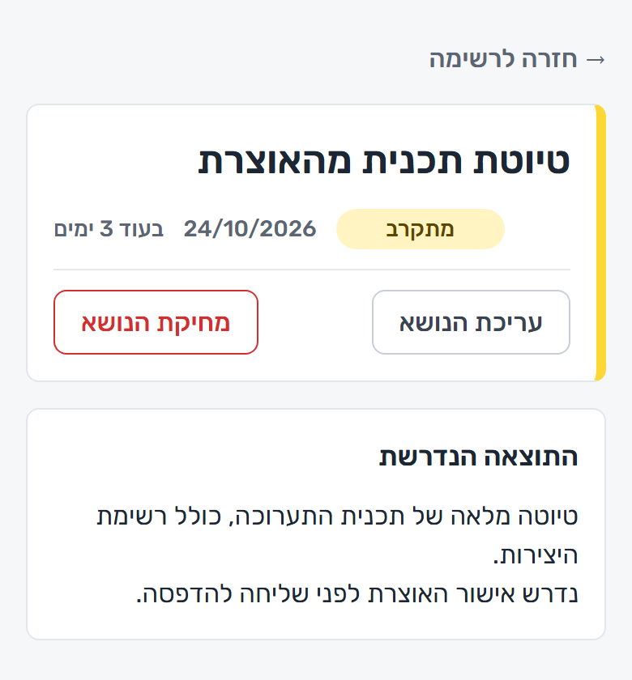
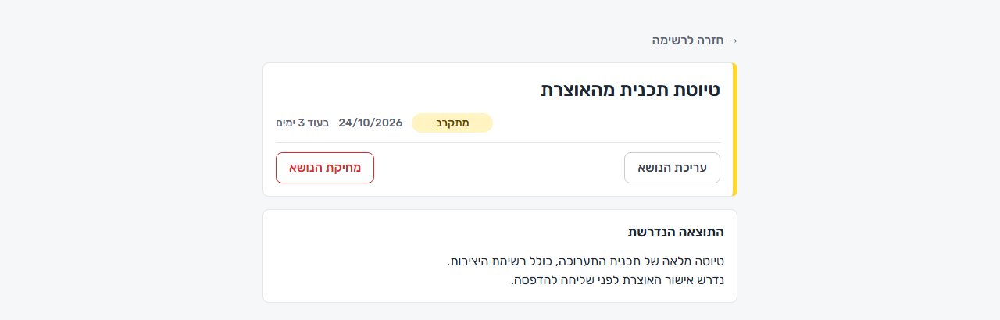
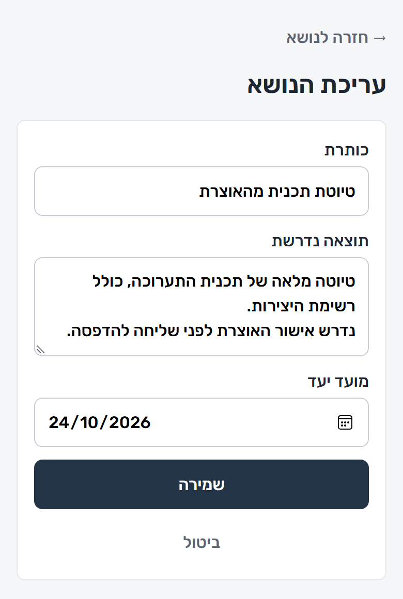
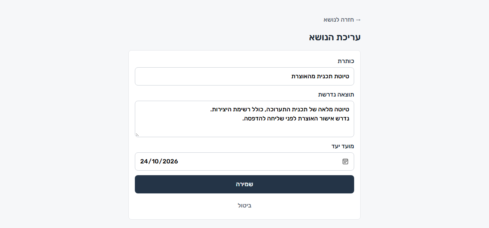
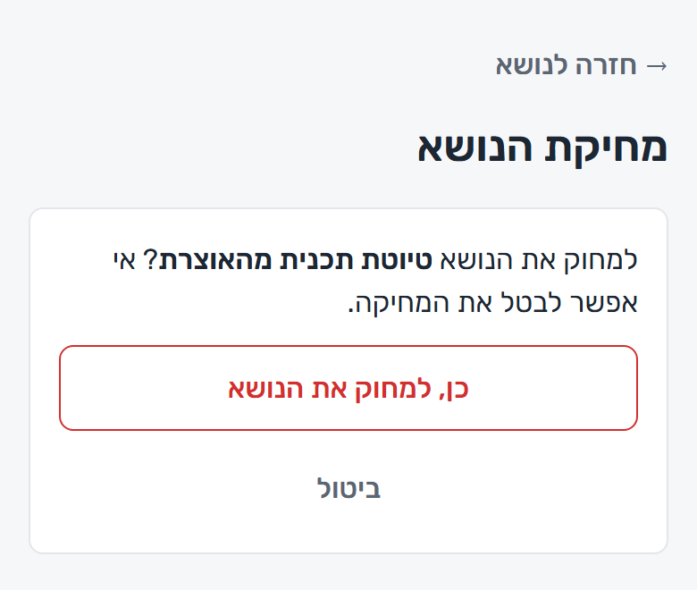
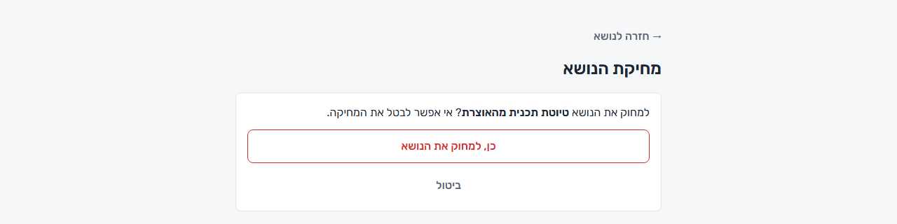
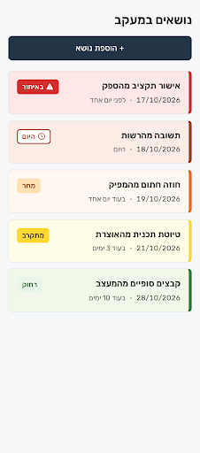
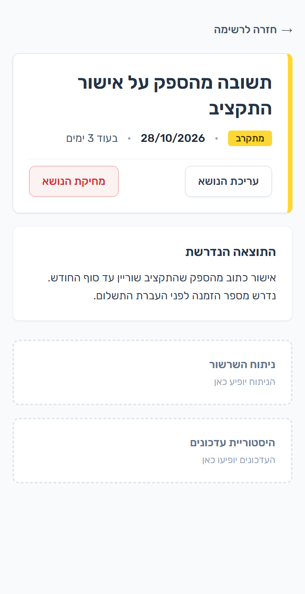

[עברית](README.md) | **English**

# Dependency Follow-up Assistant

A tool for tracking topics that are waiting on someone else (a supplier, a colleague, an authority). Each topic has a deadline, and the code computes how many days remain and marks the topic with one of five urgency levels. The UI is in Hebrew, right to left.

The project is built in small stages. Implemented so far: **stage 1 (gate 1)**: saving a deadline and showing it in a colour by days remaining, **stage 2**: the Stitch design, in the templates and the CSS file, and **stage 3**: several topics with a required outcome, a detail page, editing and deletion. The spec is in [`docs/spec.md`](docs/spec.md) and the full plan in [`docs/plan.md`](docs/plan.md) (both in Hebrew).

## Urgency levels

The thresholds are defined once, in `app/core/deadlines.py`. Days are calendar days by date only, in Israel time (`Asia/Jerusalem`).

| Days remaining | Level | Label (shown in the UI) |
|---|---|---|
| 6 or more | `far` | בהמשך (later) |
| 2–5 | `approaching` | מתקרב (approaching) |
| 1 | `tomorrow` | מחר (tomorrow) |
| 0 | `today` | היום (today) |
| below 0 | `overdue` | באיחור (overdue) |

## Architecture

Three layers with a one-way dependency, so the UI can be swapped without touching the logic:

```
web  ──►  core      (pure logic, no Flask and no DB)
 │
 └─────►  storage   (SQLAlchemy Core, SQLite)
```

| Component | Files | Role |
|---|---|---|
| `app/core/` | `deadlines.py` | Days remaining (`days_remaining`), the urgency level (`urgency_level`), the Hebrew wording (`days_text`) and "today" in Israel time (`today_in_israel`). Pure functions that take `today` as a parameter, so tests are deterministic. |
| `app/storage/` | `db.py`, `repository.py` | The `topics` table definition (title, required outcome, deadline) and the `add_topic`, `list_topics`, `get_topic`, `update_topic` and `delete_topic` functions. The connection is set by `DATABASE_URL` (default `sqlite:///data/app.db`). An empty title or outcome is rejected, as is a title longer than 200 characters or an outcome longer than 2000. |
| `app/web/` | `__init__.py`, `routes.py`, `templates/`, `static/` | The Flask app: `create_app()` (loads `SECRET_KEY` from `.env` and enables CSRF protection), the list, create, detail, edit and delete routes, and Jinja2 templates with automatic escaping. |
| `run.py` | | Starts the local server on `127.0.0.1:5000`. |
| `.env.example` | | A template for the local settings (`SECRET_KEY`). The `.env` file itself is not committed to git. |
| `tests/` | | pytest tests for all three layers. |

The app's routes:

| Route | What it does |
|---|---|
| `GET /` | The topic list and the add form |
| `POST /` | Creates a topic |
| `GET /topics/<id>` | The topic detail page |
| `GET /topics/<id>/edit`, `POST /topics/<id>/edit` | The edit form, and saving the changes |
| `GET /topics/<id>/delete` | The delete confirmation page (deletes nothing) |
| `POST /topics/<id>/delete` | Deletes the topic |

Every POST request requires a CSRF token, and without one the response is 400 on a Hebrew error page. A topic id that does not exist returns a Hebrew 404.

## Data flow

**Adding a topic (`POST /`):**
1. The form submits a title, a required outcome, a date and a CSRF token. A request without a valid token (the same goes for editing and deleting) is rejected with 400 and a Hebrew error page ("הטופס פג תוקף או שאינו תקין", "the form expired or is invalid"), and nothing changes.
2. The route validates the date, and `add_topic` strips surrounding whitespace and rejects an empty or too long title or outcome.
3. The topic is saved in the `topics` table.
4. The browser is redirected to `GET /` (303 redirect). On an error the page comes back with status 400 and a Hebrew message, and the input is kept.

**Showing the list (`GET /`):**
1. `list_topics` fetches the topics sorted by deadline.
2. For each topic, `days_remaining` computes the days remaining against `today_in_israel()`, and `urgency_level` sets the level.
3. The template shows the title, the date, the days wording and a label, with the CSS class `level-<level>`. For "today" and "tomorrow" the days wording is not shown, because it repeats the label (display only). Colour is not the only carrier of the information, because there is also a text label. Each card is a link as a whole, leading to the topic detail page.

**Detail, edit and delete (`/topics/<id>`):**
1. The detail page shows the title, the level, the deadline and the required outcome. An id that does not exist returns a Hebrew 404.
2. Editing (`/edit`) uses the same validation as creating, and on an error the topic is left unchanged.
3. Deletion: `GET /delete` shows a confirmation page and deletes nothing. The deletion itself is POST-only, with a CSRF token.

Urgency is computed in code only.

## Installation

Tested with Python 3.14.7 on Windows 11. Other Python versions, as well as Linux and macOS, were not tested.

The dependencies in `requirements.txt`: `flask`, `sqlalchemy`, `flask-wtf` (CSRF protection), `python-dotenv` (loading `.env`), `tzdata` (Windows has no built-in time zone database) and `pytest`.

**Windows (PowerShell):**

```
git clone https://github.com/Maya-Klein/dependency-followup.git
cd dependency-followup
python -m venv .venv
.venv\Scripts\python -m pip install -r requirements.txt
$key = .venv\Scripts\python -c "import secrets; print(secrets.token_hex(32))"
"SECRET_KEY=$key" | Set-Content -Path .env -Encoding ascii
```

The last two lines generate a random key and write it to `.env`. `SECRET_KEY` is needed for CSRF protection, and the app does not start without it. `-Encoding ascii` avoids a BOM, which may get in the way of reading the file. You can also copy `.env.example` to `.env` and fill in the value by hand. The `.env` file is not committed to git.

**Linux and macOS (not tested):**

```
git clone https://github.com/Maya-Klein/dependency-followup.git
cd dependency-followup
python3 -m venv .venv
.venv/bin/python -m pip install -r requirements.txt
echo "SECRET_KEY=$(.venv/bin/python -c 'import secrets; print(secrets.token_hex(32))')" > .env
```

## Running

```
# Windows (PowerShell)
.venv\Scripts\python run.py

# Linux / macOS (not tested)
.venv/bin/python run.py
```

The app is available at http://127.0.0.1:5000. The DB file is stored in `data/app.db` (not committed to git). You can change it with the `DATABASE_URL` variable.

## Tests

```
# Windows (PowerShell)
.venv\Scripts\python -m pytest

# Linux / macOS (not tested)
.venv/bin/python -m pytest
```

The tests cover the boundary values of the levels, month and year transitions, the time zone around midnight, saving and loading from a fresh connection, an empty or too long title and outcome, an invalid date, a title and outcome containing HTML code that are shown as text on every page, creating, editing and deleting (including the 404 and POST-only deletion), hiding the days wording for "today" and "tomorrow", and CSRF protection (a request with no token, a wrong token or a token from another session is rejected and changes nothing).

The tests do not need a `.env` file: they set their own `SECRET_KEY`.

## What the app does and does not do

**Does (stages 1–3):**
- Saves a topic with a title, a required outcome and a deadline. All fields are mandatory.
- Computes in code how many days remain (calendar days, Israel time) and marks the topic with one of five levels, with a colour and a text label.
- Shows the list sorted by deadline, with a link to the topic detail page. The title and the outcome are shown as text, even if they contain HTML, and a multi-line outcome keeps its line breaks.
- Lets you edit a topic (title, outcome and deadline) and delete it, after a confirmation page. Deletion is POST-only, and every form is protected by a CSRF token (Flask-WTF).

**Does not (yet):**
- No open/closed status or milestone.
- No update history and no AI analysis of threads.
- No login, multiple users or cloud deployment. A single user on `127.0.0.1`.

## Comparison with monday.com

- **The core idea:** the system distinguishes real progress from a report of progress. "We're on it" is a report. A dated written confirmation is progress. The check is made against a defined required outcome, with verified quotes from the correspondence.
- **monday.com (AI Risk Insights):** identifies risks from data and conversations inside the tool, at the level of teams and project portfolios. Here an external correspondence that is pasted into the system is analysed, and the tool is meant for one person who tracks dependencies on external parties.
- **What is implemented so far:** the required outcome and the deadline (stages 1–3). Pasting a thread and the AI analysis, including the distinction between a report and progress and the quote verification, are planned for stages 4–6 and do not exist yet.
- **Basis of the comparison:** monday.com's documentation only, not hands-on use.

## Known limitations

- Days are counted by calendar only, with no working days, weekends or holidays.
- The level thresholds are fixed in the code and cannot be configured.
- Stage 3 added a column (`required_outcome`) to the `topics` table. If you have a `data/app.db` from before stage 3, delete it. Schema changes in the coming stages will require this too.
- `pip-audit` was run on `requirements.txt` on 19.10.2026 and again on 21.10.2026 (after adding `flask-wtf` and `python-dotenv`), and both runs found no known vulnerabilities. It is worth running again when dependencies are added.
- In Stitch only the mobile list screen and the mobile topic detail screen were approved. The desktop and edge-state screens generated there in stage 2 were not verified, and the edit and delete confirmation pages were built directly in code.
- The `designMd` in Stitch is out of sync with the code (a background tint for every level, the colour of the "approaching" badge, a solid "today" badge, a delete button without a fill). A new screen generated there may not match the app.

## Next steps

According to [`docs/plan.md`](docs/plan.md), one stage at a time:

1. **Stage 4:** a dated update history (including a pasted thread) that is never overwritten, with deletion of an update entered by mistake.
2. **Stage 5:** AI analysis of a thread, isolated and without a UI, with quote verification in code.
3. **Stage 6:** connecting the analysis to the app.
4. **Stage 7:** open/closed status and milestone.
5. **Stage 8:** synthetic scenarios, and gate 3.

The order was changed on 21.10.2026 after lecturer feedback: an AI component is mandatory, so it was moved ahead of status and scenarios.

Ideas outside the MVP are collected in the "בהמשך" (later) section of `docs/plan.md`.

## Design

The design was made in Stitch (project "מעקב תלויות – שער 1 (סופי)", "Dependency tracking – gate 1 (final)") and implemented in stage 2, in the templates and the CSS file only (`app/web/templates/`, `app/web/static/style.css`), without touching `storage/`. In `core/` only two strings changed (the "בהמשך" label and the wording of "יום"). The font is Rubik, hosted locally in `app/web/static/fonts/` (variable font, Hebrew and Latin subsets, OFL licence) rather than loaded from Google Fonts, so the page makes no third-party requests. RTL is complete, corners are 8px, and each topic is a card with a 6px colour stripe on the right.

- **A badge on every level:** colour is not the only signal. All badges have the same width, and their colour intensity grows as the deadline approaches.
- **"Today" versus "overdue":** "today" is a solid dark brown-orange badge with a clock icon, and "overdue" is a solid red badge with a warning icon. Only these two give the card a coloured background. For "today" and "tomorrow" there is no days wording, because it repeats the badge.
- **Mobile:** a single column. The list comes first, and the form opens from the "+ הוספת נושא" (+ add topic) button (`details/summary`, no JavaScript). After an error the form comes back open.
- **Desktop:** a wide list on the right, and the form in a side column, titled "הוספת נושא" (add topic).
- **A clickable card:** every card in the list is a link to the detail page, with a small chevron on the left aligned to the title row.
- **The detail page:** a title card with a colour stripe, a badge, the deadline, and the buttons "עריכת הנושא" (edit the topic) and "מחיקת הנושא" (delete the topic) in one row at its bottom. "Delete the topic" has no fill: red text and a thin red border. Below it is a "התוצאה הנדרשת" (the required outcome) card. The page is a narrow column (40rem) on desktop too. Its mobile design was made in Stitch and approved (the picture below), and the implementation uses the colours of `style.css`, not Stitch's.
- **Edit and delete confirmation:** built in code in the same style, with no separate Stitch design. Deletion happens only after a confirmation page.

Screenshots of the running app, from `docs/screenshots/` (Windows 11, Edge, mobile at 390 px wide and desktop at 1280 px wide, with sample data):

| Screen | Mobile | Desktop |
|---|---|---|
| List and add form |  |  |
| Topic details |  |  |
| Edit |  |  |
| Delete confirmation |  |  |

The initial design from Stitch was the starting point. In the implementation I changed several things after testing in the browser: a coloured background only for the urgent cards ("today" and "overdue"), badges of uniform width, the label "בהמשך" (later) instead of "far", and on desktop a form in a side column.



The mobile topic detail screen as approved in Stitch (stage 3). In the implementation the colours are those of `style.css`, and the "מחיקת הנושא" (delete the topic) button has no fill:



## Development process and tools

- **Model split:** planning with Opus, execution and code writing with Sonnet.
- **Small stages:** one stage at a time, following the plan. A plan for every non-trivial change, and approval before execution.
- **Tests:** end-to-end pytest, edge cases and regression after every stage, and fixing failures before moving on.
- **Security review:** after every stage (injection, input, secrets, information exposure). Findings are reported and fixed only with approval. The stage 3 review found that the delete and edit routes were open to CSRF, and it was fixed in the same PR (Flask-WTF).
- **Git:** a new branch for every feature, never a direct commit to `main`, and a commit after every completed action.
- **Obsidian:** a work log in the vault, in the `dependency-followup` folder. A `Stop` hook (`.claude/settings.json` and `.claude/hooks/log_task.py`) adds a short entry at the end of each round with the branch, commit and a summary. Detailed entries (decisions, open issues, next step) are written by hand.
- **Test hook:** another `Stop` hook (`.claude/hooks/run_tests.py`, registered in `.claude/settings.json`) runs the whole pytest suite at the end of each round, but only if `py`, `html` or `css` files changed since the last green run. A docs-only change does not run the tests. When a test fails, the hook blocks the end of the round and feeds the error back, and it must be fixed before continuing.
- **Stop and alert after 3 failures:** on the third consecutive failure the hook stops blocking and raises an alert: a warning sound different from the usual one, a Windows dialog, a Hebrew message and an entry in the Obsidian log. The alert fires once, and a green run resets the count. The last-run state and the count are kept in `data/.last_tested` and `data/.test_failures` (not committed to git).
- **GitHub CLI (`gh`):** opening and merging pull requests from the terminal.
- **Stitch MCP:** creating the design and the design system directly from Claude Code.
- **Obsidian MCP:** reading and writing the vault from within the session.
- Skills used: frontend-design, security-review.
