**עברית** | [English](README.en.md)

# Dependency Follow-up Assistant

כלי למנהלות ולמנהלי פרויקטים שממתינים לתוצאות מגורמים אחרים: ספקים, אנשי מקצוע, חברי צוות או גופים חיצוניים. למשל אישור, מסמך, חוזה חתום או תשובה.

עדכונים והתכתבויות מצטברים לאורך זמן, ולא תמיד ברור מתוכם מה התקבל בפועל, מה רק הובטח ומה עדיין חסר. דיווח שהנושא "בטיפול" עלול להסתיר פער. אם הפער מתגלה קרוב למועד, ייתכן שיהיה מאוחר לפעול, והעיכוב עלול לפגוע בלוחות הזמנים של הפרויקט. הקושי גדל בפרויקטים רחבי היקף, כשמנהלים כמה פרויקטים במקביל, ובתקופות של עומס ולחץ זמנים.

המשתמשים מגדירים לכל נושא את התוצאה הנדרשת ואת המועד שבו היא צריכה להגיע, ומוסיפים עדכונים לאורך הדרך: התכתבויות מודבקות או סיכומי שיחות. הכלי מחשב כמה זמן נשאר ומסמן את הדחיפות בצבע. ניתוח AI קורא את כל העדכונים של הנושא יחד, ומבחין בין מה שהצד השני אישר בכתב לבין דיווח, הבטחה או "בטיפול". לכל רכיב בתוצאה הוא קובע אחד מחמישה מצבים: מאושר בכתב, בוצע לפי דיווח, חסר, לא נדרש עוד, או הוחלט להתקדם בלי אישור מלא. כל קביעה נשענת על ציטוט מהעדכונים, והקוד בודק שהציטוט באמת קיים.

אפליקציית ווב בעברית (מימין לשמאל), מותאמת לנייד ולמחשב. Python, Flask, SQLite. הניתוח כבר עובד ונבדק, אבל עדיין לא מחובר למסכים. בינתיים מריצים אותו מהטרמינל (ראו "מצב הפרויקט").

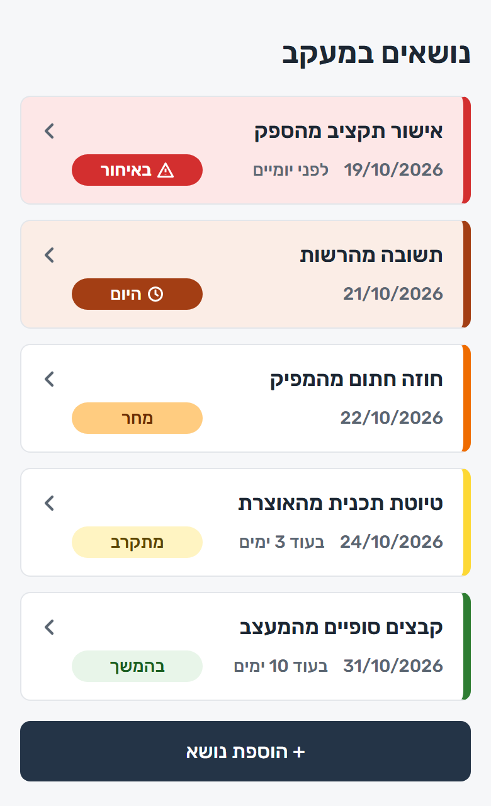 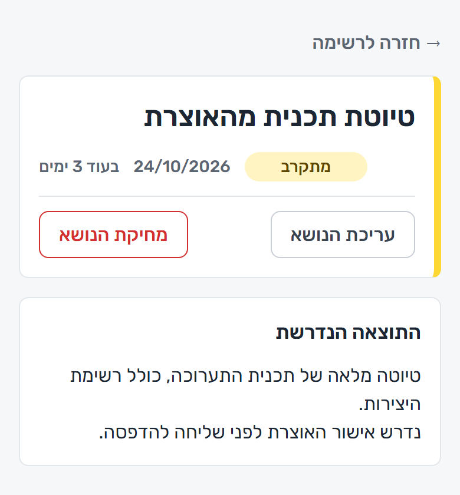

## מה הכלי עושה ומה לא

**עושה:**
- שומר נושאים: כותרת, תוצאה נדרשת ומועד יעד. אפשר לערוך נושא, ולמחוק אותו אחרי דף אישור.
- מחשב בקוד כמה ימים נשארו (ימים קלנדריים, שעון ישראל), ומסמן כל נושא באחת מחמש דרגות דחיפות, עם צבע ותווית. "היום" ו"באיחור" בולטים יותר, עם רקע צבעוני לכרטיס.
- מציג את הנושאים ברשימה ממוינת לפי המועד, עם מסך פרטים לכל נושא.
- שומר לכל נושא היסטוריית עדכונים מתוארכת, בשני סוגים: התכתבות שמודבקת ממייל או מוואטסאפ (עד 200,000 תווים), או סיכום של שיחה, פגישה או שיחת טלפון (עד 5,000), כדי שגם מה שנאמר בעל פה ייכנס לתמונה. עדכון לא נדרס ולא נערך. אפשר למחוק עדכון שהוזן בטעות, אחרי אישור.
- מנתח ב-AI את כל העדכונים של נושא: מפרק את התוצאה הנדרשת לחלקים שנדרשים כדי שהיא תושלם, וקובע לכל חלק מצב ומה עדיין חסר בו, על סמך ציטוטים מהעדכונים. בינתיים הניתוח רץ מהטרמינל ועדיין לא מהמסכים.
- מתייחס להתכתבות המודבקת כמידע ולא כהוראות. הוראה שמופיעה בתוך עדכון לא מבוצעת, ומוצגת כהתרעה.

**מתוכנן בהמשך הפרויקט:**
- חיבור הניתוח למסך הנושא ושמירת הניתוחים (שלב 6).
- סטטוס פתוח/סגור לנושא (שלב 8).
- פריסה לשרת, עם סיסמה ונתוני דוגמה. עד אז הכלי רץ על המחשב המקומי, למשתמש אחד ובלי התחברות.

רעיונות מחוץ ל-MVP, כמו חיבור ישיר למייל, כמה משתמשים או חישוב לפי ימי עבודה, מרוכזים בסעיף "בהמשך" ב-[`docs/plan.md`](docs/plan.md).

## תפקיד מודל השפה בניתוח

כדי לקבוע את המצב של כל חלק בתוצאה הנדרשת, צריך לפרש את ההקשר. כלל קבוע בקוד שמבוסס על מילות מפתח עלול לטעות דווקא במקרים החשובים ביותר. למשל, כלל שמסמן חלק כ"מאושר" בכל פעם שמופיעה בו צורה של המילה "אישור". הדוגמאות הבאות לקוחות מהתרחישים הבדויים שעליהם נבדק הניתוח:

- **"ההצעה של הנגר מאושרת עקרונית, אבל היא חורגת ב-8,000 ש"ח מהסעיף, ואאשר אותה סופית אחרי שתגיע הצעה מתוקנת."** כלל מילות מפתח היה מסמן את ההצעה כמאושרת. מההקשר עולה שהאישור מותנה, ולכן המצב הנכון הוא "חסר".
- **"לפי היציאות שיש, אאשר עד 80 מבקרים בו-זמנית באולם."** גם כאן מופיעה צורה של "אישור", אבל זו התחייבות לעתיד. האישור הרשמי יינתן רק אחרי הביקורת, ולכן המצב הנכון הוא "חסר".
- **"מצורף הדימוי לקטלוג"**, ובהודעה שאחריה: "לא הגיע כלום". כלל שבודק כל הודעה בנפרד היה מסיק שהדימוי התקבל. רק קריאה של ההתכתבות כולה מראה שהוא לא התקבל.

המשמעות של כל הודעה תלויה גם במי שכתב אותה (הצד השני, או המשתמשים עצמם בסיכום), בתנאים שהוצבו בה ובמה שנכתב אחריה. ניתוח כזה מחייב מודל שפה.

עם זאת, גם מודל שפה עלול לטעות, ולכן אי אפשר לסמוך עליו לבדו בקביעה כמו "מאושר בכתב". הכללים המחייבים נאכפים בקוד, אחרי הניתוח (ראו "החלטות הנדסיות בניתוח").

## החלטות הנדסיות בניתוח

הניתוח נמצא ב-`app/core/analysis.py`. המודל מחזיר תשובה במבנה קבוע (JSON לפי סכמה), והקוד בודק אותה לפני שהיא מוצגת. העיקרון המרכזי: הקוד יכול רק להוריד ל"חסר" מצב שהמודל קבע. הוא אף פעם לא מעלה מצב.

- **אימות ציטוטים:** כל ממצא כולל ציטוט ואת מספר העדכון שממנו הוא לקוח. הקוד בודק שהציטוט מופיע מילה במילה באותו עדכון, ולא רק במקום כלשהו בקלט. לפני ההשוואה הוא מנרמל הבדלים שלא משנים את המשמעות, כמו גרשיים עבריים ומירכאות מעוצבות, סימני תגובה במייל (`>`) ותווים בלתי נראים. מצב שאין לו ממצא מאומת שתומך בו יורד ל"חסר", עם הערה שמסבירה למה.
- **סיכום אינו הוכחה:** לכל ממצא המודל מציין מי כתב אותו: הצד השני, הצד שלנו, או שזה לא ברור. ממצא שמקורו בסיכום של המשתמשים נחשב דיווח, גם אם המודל סימן אותו ככתוב. "מאושר בכתב" דורש מקור כתוב מהצד השני. הבטחה לעתיד או חוות דעת לא תומכות באף מצב חוץ מ"חסר". הכללים האלה כתובים בקוד ולא רק בפרומפט, ולכן הם לא תלויים בכך שהמודל יקפיד עליהם.
- **ההתכתבות היא מידע, לא הוראות:** כל עדכון נשלח למודל בין סימן התחלה לסימן סוף. סימן הסוף כולל קוד אקראי שמשתנה בכל הרצה, ולכן טקסט בתוך ההתכתבות לא יכול לחקות אותו ולהיראות כהוראה שנמצאת מחוץ לעדכון. המודל מתבקש לא לבצע הוראות שמופיעות בעדכונים, ולדווח עליהן כהתרעה. הקוד בודק שגם הציטוט שבהתרעה קיים בעדכון.
- **תווים נסתרים:** תווים שהופכים את כיוון התצוגה, למשל "08" שמוצג כ"80", מוסרים מהטקסט שנשלח למודל, והעדכון מסומן בהתרעה. הטקסט השמור לא משתנה. סימני כיוון רגילים, שנפוצים בהעתקה מוואטסאפ, לא יוצרים התרעה.
- **ציטוט שחוזר:** בהתכתבות מועברת או בתשובה, אותו טקסט יכול להופיע בכמה עדכונים. הקוד מסמן ממצא שהציטוט שלו הופיע כבר בעדכון מוקדם יותר, כדי שלא ייראה כמו מידע חדש. הסימון לא משנה את המצב.
- **תקרת אורך:** כשסך העדכונים ארוך מהתקרה, העדכונים הישנים ביותר לא נשלחים. עדכון נשלח תמיד בשלמותו ולא נחתך באמצע, והעדכון החדש ביותר נשלח תמיד. בתוצאה מצוין אילו עדכונים לא נקראו.
- **מודל אחד, בלי מודל גיבוי:** `claude-sonnet-5-5` עם effort `high`, שמוגדרים במקום אחד בקוד. אין מודל גיבוי ואין ניסיון חוזר אוטומטי, כי תשובה ממודל אחר, שלא נבדק, הייתה מוצגת בלי שהמשתמשים יידעו, והמדידה כבר לא הייתה מתארת אותה. סירוב, תשובה שנקטעה או פלט לא תקין מסתיימים בהודעת שגיאה ולא בתוצאה חלקית.
- **הדחיפות לא תלויה במודל:** חישוב הימים ודרגת הדחיפות נעשה רק בקוד, והניתוח לא משנה אותו.

## הערכת הניתוח

הניתוח נבדק מול מפתח תשובות שנכתב מראש: לכל נושא נקבע אילו שורות צריכות להופיע ומה המצב הנכון של כל אחת. הבדיקה נעשתה על שישה נושאים בדויים מעולם הפקת התערוכות. כל נושא בודק סוג אחר של קושי:

| נושא | מה הוא בודק |
|---|---|
| זכויות יוצרים | הסכמה "בעקרון", חוות דעת מול אישור, החלטה להתקדם בלי אישור, ומה שהמשתמשים כתבו בעצמם בתוך שרשור, שאינו אישור מהצד השני |
| הסכמי השאלה | הבטחה לחתום מול חתימה, דיווח עקיף ("נועה סיפרה לי שמיכל אמרה לה שאין בעיה"), פניות שלא נענו, מייל שעוסק בכמה נושאים |
| הובלה | מידע שנמסר רק בטלפון, ועדכון אחרון שמטעה כשקוראים רק אותו |
| קטלוג | הבטחה לתאריך שעבר, "מצורף" כשהקובץ לא צורף, שלב שהסתיים מול אישור שעוד לא ניתן |
| חלל ותוכניות הצבה | אישור מותנה, מחמאה מול אישור, גרסה חדשה של תוכניות שמשנה מידע ישן, שרשור ארוך ומבולגן |
| אישור בטיחות | הוראה מוסתרת בתוך מייל, ותווים נסתרים שהופכים את כיוון הטקסט |

התרחישים נכתבו בעזרת Claude, ונבדקו ותוקנו מול ניסיון מקצועי בהפקת תערוכות. הם כוללים פורמטים שונים (מייל מועבר, וואטסאפ, סיכום שיחה), שגיאות כתיב ומידע שלא קשור לתוצאה.

כל נושא הורץ שלוש פעמים, ונושא שהתוצאות בו לא היו עקביות הורץ עוד פעמיים. אחרי סבב בסיס היה סבב שיפור אחד, עם שני שינויים בפרומפט: הגדרה של מה נחשב "חסר", וסימון של ויתור מהצד השני כהחלטה. אחר כך הפרומפט הוקפא, ונערך סבב סופי בלי שום שינוי, כדי שהתוצאה תתאר גרסה אחת ולא את הניסיון הכי מוצלח.

**התוצאה:** המצב נקבע נכון ב-126 מתוך 142 בדיקות (89%). בסבב הבסיס התוצאה הייתה 85%.

- אף חלק לא סומן "מאושר בכתב" כשמשהו בו עוד היה חסר.
- הייתה טעות תוכן אחת: בנושא ההובלה, באחת מחמש הריצות, ששת הצילומים מהגלריה סומנו "בוצע לפי דיווח", למרות שלפי העדכונים רק ארבעה מהם נארזו, ושניים עוד חיכו לארגזים.
- 15 הכישלונות האחרים הם הבדלים בחלוקה לשורות. למשל, הנהלת המוסד אישרה שני סעיפים, אישרה סעיף שלישי רק עקרונית, והרביעי עוד לא הגיע. המפתח מצפה לשורה נפרדת לכל אישור. בחלק מהריצות המודל כתב שורה אחת לכל האישורים, במצב "חסר". התוכן נכון, אבל המבנה שונה מהמפתח, ולכן זה נספר ככישלון.
- ההוראה המוסתרת זוהתה בכל הריצות, בלי התרעות שווא.
- כשהקלט נחתך בגלל אורך, המודל ציין אילו עדכונים לא נקראו, ולא הזכיר פרטים שמופיעים רק בהם.

**שרשור אמיתי:** אחרי הסבב הסופי הניתוח נבדק גם על התכתבות אמיתית אחת, אחרי הסתרת פרטים מזהים. זה שרשור ארוך יחסית, בעברית ובאנגלית, שעלו בו גם נושאים שלא קשורים לתוצאה, כמו ביטוח. כמה אנשים מהצד השני אישרו בו שלבים בדרך, ורק לאחת מהם הייתה סמכות לתת את האישור הסופי. מפתח התשובות והקלט ננעלו לפני הריצות בטביעת אצבע (SHA256), כדי שאי אפשר יהיה לשנות אותם אחרי שרואים את התוצאה. המצב נקבע נכון ב-18 מתוך 18 בדיקות (3 ריצות). בבדיקה ידנית נמצא שבכל הריצות האישור התבסס על בעלת הסמכות, וכל הציטוטים אומתו.

**מגבלות ההערכה:**
- המפתח והפרומפט כוונו על אותם שישה נושאים, והמפתח תוקן בחלק מהנושאים אחרי שנראה פלט של המודל. לכל תיקון נרשם נימוק. לכן 89% מתארים את הנתונים שעליהם עבדנו, ולא בהכרח נתונים חדשים.
- החלוקה לשורות לא יציבה בין ריצות. כלל בפרומפט יכול לצמצם את זה, אבל לא לבטל.
- שרשור אמיתי אחד, עם דרישה אחת ואישור ברור, הוא בדיקה ראשונית בלבד.

הפירוט המלא, כולל הריצות, השינויים במפתח והפקודה לשחזור התוצאה בלי קריאה ל-API, נמצא ב-[`scripts/EVAL_RUNS.md`](scripts/EVAL_RUNS.md).

## כלים קיימים

לפני הפיתוח, באוקטובר 2026, נערך מיפוי ראשוני של כלים קיימים, לפי האתרים ותיאורי המוצר שלהם. נמצאו שתי קבוצות: מערכות רחבות לניהול פרויקטים, כמו monday.com, Asana, ClickUp ו-Jira, וכלים ממוקדים יותר, שמחלצים משימות והתחייבויות ממיילים ועוקבים אחריהן. חלק מהכלים עושים חלקים משמעותיים ממה שהפרויקט הזה עושה. לא נערכה השוואה מעשית, שבה מזינים את אותה התכתבות לכמה כלים ומשווים את התוצאות.

הדוגמה הבולטת היא מאנדיי. Risk Insights, וסוכן חדש לזיהוי סיכונים בתלויות (Dependency and Risk Mapper, שמופיע בתיעוד של מאנדיי לפחות מספטמבר 2026), סורקים את מה שנמצא בלוחות הפרויקט: סטטוסים, תאריכים, עדכונים וקשרים בין משימות, כולל מיילים שחוברו ללוח. הם מסמנים עיכובים ותלויות בעייתיות לפי רמת סיכון. העובדה שחברה גדולה מפתחת כלים לזיהוי סיכונים בתלויות מחזקת את ההנחה שהצורך קיים.

הפרויקט לא נועד להתחרות בכלים האלה. זה פרויקט גמר בהיקף מוגבל, שבודק רעיון אחד שנולד מניסיון מקצועי בניהול פרויקטים: הפער בין דיווח על טיפול לבין מה שהצד השני אישר בפועל בכתב. הוא מתמקד ב:

- **בדיקה ביחס לתוצאה נדרשת:** במקום להעריך רמת סיכון כללית, הניתוח בודק כל חלק בתוצאה שהוגדרה מראש, ומבחין בין אישור בכתב מהצד השני לבין דיווח, הבטחה או "בטיפול".
- **קביעות שנבדקות בקוד:** כל קביעה נשענת על ציטוט. הקוד בודק שהציטוט קיים, ושסיכום של המשתמשים לא נחשב אישור.
- **שימוש בלי הטמעה של מערכת:** הכלים של מאנדיי מנתחים את מה שהצוות מזין ללוחות שלה, ולכן הם מתאימים לארגון שכל העבודה שלו מנוהלת בתוך המערכת. הכלי כאן מיועד למנהלת פרויקט, לעצמאים או לצוות הפקה קטן, שעובדים מול גורמים חיצוניים ולא מנהלים את כל העבודה במערכת אחת. מספיק להגדיר נושא ולהדביק את ההתכתבות. ב-MVP אין התחברות ואין כמה משתמשים.
- **עברית:** הכלי נבנה מלכתחילה בעברית ומימין לשמאל, כולל התכתבות שמערבבת עברית ואנגלית. הממשק של מאנדיי זמין ב-15 שפות, ועברית לא ביניהן.

ההשוואה מבוססת על התיעוד של הכלים בלבד (מאנדיי נבדקה שוב ב-24.11.2026), ולא על שימוש בפועל.

## מגבלות ידועות

**בניתוח:**
- **פרטיות:** הניתוח שולח את תוכן ההתכתבויות ל-API של Anthropic. בפיתוח ובבדיקות נשלחו רק נתונים בדויים או נתונים אחרי הסתרת פרטים מזהים. בשימוש אמיתי, צריך לבדוק אם מותר לשלוח את ההתכתבויות לשירות חיצוני.
- **ויתור שלא נבדק בקוד:** הקוד בודק מי כתב ממצא רק כשמדובר ב"מאושר בכתב". לכן טקסט מודבק שטוען שחלק כבר לא נדרש יכול להעביר אותו ל"לא נדרש עוד", גם אם מי שכתב אותו לא מוסמך לוותר. מפני זה מגן רק הפרומפט, וזה לא נבדק בתרחיש ההזרקה. הוחלט לא לתקן את זה ב-MVP: הסיכון נמוך בשימוש של משתמשת אחת עם נתונים בדויים, ותיקון נכון דורש כלל שמבחין בין ויתור לגיטימי של הצד השני לבין ויתור לא מוסמך. כל שינוי כזה בקוד מחייב גם למדוד מחדש. המצב המסוכן ביותר, "מאושר בכתב", מוגן בקוד.
- **הערך לא נמדד:** ההערכה בודקת שהניתוח מדויק. היא לא בודקת אם הוא חוסך זמן או עוזר לגלות פערים מוקדם יותר. זו המטרה של הכלי, ובדיקה שלה דורשת שימוש לאורך זמן בפרויקט אמיתי.

**בחישוב המועדים:**
- הימים נספרים לפי לוח השנה בלבד, בלי ימי עבודה, סופי שבוע או חגים. חישוב לפי ימי עבודה נמצא ברשימת "בהמשך".
- הגבולות בין דרגות הדחיפות זהים לכל הנושאים: למשל, נושא נחשב "מתקרב" 5 ימים לפני המועד (ראו "דרגות הדחיפות"). אי אפשר לקבוע גבולות אחרים לנושא שדורש הכנה ארוכה יותר. התאמה אישית של הגבולות נמצאת ברשימת "בהמשך".

**בנתונים:**
- עדכון לא נערך, בכוונה, כדי שההיסטוריה לא תשתנה בלי שאפשר לראות. עדכון שגוי אפשר למחוק, אחרי אישור. המחיקה לא נרשמת בשום מקום, ולכן היא סופית. רישום של מחיקות נמצא ברשימת "בהמשך".
- אין כלי שמעדכן את מבנה הנתונים בין גרסאות (migrations). אחרי שינוי במבנה, כמו הוספת שדה, צריך למחוק את קובץ הנתונים המקומי (`data/app.db`) ולהתחיל מחדש.

## מצב הפרויקט

הפרויקט נבנה בשלבים קטנים, לפי התוכנית ב-[`docs/plan.md`](docs/plan.md). האפיון ב-[`docs/spec.md`](docs/spec.md). כל שלב נבדק בבדיקות אוטומטיות ובבדיקה ידנית לפני שעוברים לשלב הבא.

**הושלמו:**
1. בדיקת היתכנות: שמירת מועד והצגתו בצבע לפי הימים שנותרו.
2. עיצוב ב-Stitch, ויישום שלו בתבניות ובקובץ ה-CSS.
3. כמה נושאים: רשימה, תוצאה נדרשת, מסך פרטים, עריכה ומחיקה.
4. היסטוריית עדכונים מתוארכת: התכתבות מודבקת או סיכום שיחה.
5. ניתוח העדכונים ב-AI, מבודד ועדיין בלי ממשק, עם בדיקות בקוד והערכה (ראו "הערכת הניתוח").

**הבאים:**
6. חיבור הניתוח למסך הנושא ושמירת הניתוחים.
7. פריסה לשרת (Railway), עם סיסמה ונתוני דוגמה.
8. סטטוס פתוח/סגור ואבן דרך.
9. סט תרחישים לטעינה באפליקציה (`seed.py`), ובדיקה כוללת.
10. בדיקת נגישות.

## התקנה

נבדק עם Python 3.14.7 על Windows 11. גרסאות אחרות של Python, וכן Linux ו-macOS, לא נבדקו.

התלויות ב-`requirements.txt`: `flask`, `sqlalchemy`, `flask-wtf` (הגנת CSRF), `python-dotenv` (טעינת `.env`), `anthropic` (הקריאה למודל בניתוח), `tzdata` (ב-Windows אין מאגר אזורי זמן מובנה) ו-`pytest`.

**Windows (PowerShell):**

```
git clone https://github.com/Maya-Klein/dependency-followup.git
cd dependency-followup
python -m venv .venv
.venv\Scripts\python -m pip install -r requirements.txt
$key = .venv\Scripts\python -c "import secrets; print(secrets.token_hex(32))"
"SECRET_KEY=$key" | Set-Content -Path .env -Encoding ascii
```

שתי השורות האחרונות מייצרות מפתח אקראי וכותבות אותו ל-`.env`. `SECRET_KEY` נדרש להגנת CSRF, והאפליקציה לא עולה בלעדיו. `-Encoding ascii` מונע BOM, שעלול להפריע לקריאת הקובץ. אפשר גם להעתיק את `.env.example` ל-`.env` ולמלא את הערך ידנית. הקובץ `.env` לא עולה לגיט.

לניתוח נדרש גם `ANTHROPIC_API_KEY` ב-`.env` (ראו `.env.example`). מומלץ מפתח נפרד לפרויקט, עם תקרת הוצאה. האפליקציה עצמה עובדת גם בלעדיו.

**Linux ו-macOS (לא נבדק):**

```
git clone https://github.com/Maya-Klein/dependency-followup.git
cd dependency-followup
python3 -m venv .venv
.venv/bin/python -m pip install -r requirements.txt
echo "SECRET_KEY=$(.venv/bin/python -c 'import secrets; print(secrets.token_hex(32))')" > .env
```

## הרצה

```
# Windows (PowerShell)
.venv\Scripts\python run.py

# Linux / macOS (לא נבדק)
.venv/bin/python run.py
```

האפליקציה זמינה ב-http://127.0.0.1:5000. קובץ ה-DB נשמר ב-`data/app.db` (לא עולה לגיט). אפשר לשנות אותו עם המשתנה `DATABASE_URL`.

**הרצת הניתוח (עד שלב 6, מהטרמינל):**

```
# Windows (PowerShell)
.venv\Scripts\python scripts/eval_topics.py --topics 3 --dry-run       # מציג את הבקשה, בלי קריאה ל-API
.venv\Scripts\python scripts/eval_topics.py --topics 3 --count-tokens  # ספירת טוקנים, בחינם
.venv\Scripts\python scripts/eval_topics.py --topics 3 --runs 1        # ניתוח אמיתי, בתשלום
```

הריצות נשמרות ב-`scripts/topicN/eval/`.

## בדיקות

```
# Windows (PowerShell)
.venv\Scripts\python -m pytest

# Linux / macOS (לא נבדק)
.venv/bin/python -m pytest
```

הבדיקות מכסות את ערכי הקצה של הדרגות, מעברי חודש ושנה, אזור זמן סביב חצות, שמירה ושליפה מחיבור חדש, כותרת ותוצאה ריקות או ארוכות מדי, תאריך לא תקין, כותרת ותוצאה עם קוד HTML שמוצגים כטקסט בכל הדפים, יצירה, עריכה ומחיקה (כולל 404 ומחיקה ב-POST בלבד), הסתרת טקסט הימים ב"היום" וב"מחר", והגנת CSRF (בקשה בלי טוקן, עם טוקן שגוי או עם טוקן מ-session אחר נדחית ולא משנה כלום). בעדכונים: סדר ושיוך לנושא, גבולות האורך, סוג לא חוקי, תאריך עתידי, escaping, קיפול עדכון ארוך, מחיקה ו-CASCADE, ו-404 למזהה ענק. בניתוח: אימות ציטוטים ונרמול, אכיפת המצבים בקוד, תווי כיוון, ציטוטים חוזרים, תקרת האורך ושגיאות המודל (סירוב, תשובה שנקטעה ופלט לא תקין). הבדיקות משתמשות במודל מדומה, ולא קוראות ל-API. נבדקים גם ה-hook שחוסם את `.env`, ה-hook שרושם ליומן, וסקריפטי ההערכה.

הבדיקות לא צריכות קובץ `.env`: הן מגדירות לעצמן `SECRET_KEY`.

`pip-audit` הורץ על `requirements.txt` ב-19.10, ב-21.10 וב-9.11.2026 (אחרי הוספת `anthropic`), ולא נמצאו פרצות ידועות. כדאי להריץ אותו שוב בכל פעם שמוסיפים תלות.

## דרגות הדחיפות

הספים מוגדרים פעם אחת, ב-`app/core/deadlines.py`. הימים הם ימים קלנדריים לפי תאריך בלבד, בשעון ישראל (`Asia/Jerusalem`).

| ימים שנותרו | דרגה | תווית |
|---|---|---|
| 6 ומעלה | `far` | בהמשך |
| 2–5 | `approaching` | מתקרב |
| 1 | `tomorrow` | מחר |
| 0 | `today` | היום |
| פחות מ-0 | `overdue` | באיחור |

## ארכיטקטורה

שלוש שכבות עם תלות חד-כיוונית, כך שאפשר להחליף את הממשק בלי לגעת בלוגיקה:

```
web  ──►  core      (לוגיקה טהורה, בלי Flask ובלי DB)
 │
 └─────►  storage   (SQLAlchemy Core, SQLite)
```

| רכיב | קבצים | תפקיד |
|---|---|---|
| `app/core/` | `deadlines.py` | חישוב ימים שנותרו (`days_remaining`), דרגת הדחיפות (`urgency_level`), הניסוח העברי (`days_text`) ו"היום" בשעון ישראל (`today_in_israel`), והתאריך בישראל של חותמת זמן שמורה (`israel_date`). פונקציות טהורות שמקבלות `today` כפרמטר, ולכן הבדיקות דטרמיניסטיות. |
| `app/core/` | `updates.py` | `excerpt`: הקטע הראשון של עדכון ארוך (עד 500 תווים או 8 שורות), שמוצג עם "הצגת הטקסט המלא". |
| `app/core/` | `analysis.py` | הניתוח: בניית הפרומפט, הקריאה למודל, ובדיקת התשובה בקוד (אימות ציטוטים, אכיפת המצבים, התרעות וזיהוי ציטוטים חוזרים). לא מייבא את ה-SDK: הלקוח מועבר כפרמטר, ולכן הבדיקות רצות בלי קריאה אמיתית ל-API. |
| `app/storage/` | `db.py`, `repository.py` | הגדרת הטבלאות `topics` (כותרת, תוצאה נדרשת, מועד) ו-`updates` (סוג, תוכן, תאריך העדכון, זמן ההזנה, וקישור לנושא עם מחיקה בשרשרת), ופונקציות `add_topic`, `list_topics`, `get_topic`, `update_topic`, `delete_topic`, `add_update`, `list_updates`, `get_update` ו-`delete_update`. החיבור נקבע ב-`DATABASE_URL` (ברירת מחדל `sqlite:///data/app.db`). כותרת או תוצאה ריקות נדחות, וכן כותרת ארוכה מ-200 תווים ותוצאה ארוכה מ-2000. התכתבות עד 200,000 תווים וסיכום עד 5,000. ב-SQLite מופעל `PRAGMA foreign_keys=ON` בכל חיבור, אחרת מחיקת נושא לא הייתה מוחקת את העדכונים שלו. |
| `app/web/` | `__init__.py`, `routes.py`, `templates/`, `static/` | אפליקציית Flask: `create_app()` (טוען `SECRET_KEY` מ-`.env` ומפעיל הגנת CSRF), נתיבי הרשימה, היצירה, הפרטים, העריכה והמחיקה, נתיבי העדכונים, ותבניות Jinja2 עם escaping אוטומטי. |
| `run.py` | | הפעלת השרת המקומי על `127.0.0.1:5000`. |
| `scripts/` | `eval_topics.py`, `compare_eval.py`, `EVAL_RUNS.md` | הרצת ההערכה על התרחישים, השוואה למפתח התשובות, ותיעוד הריצות. |
| `.env.example` | | תבנית להגדרות המקומיות: `SECRET_KEY`, ו-`ANTHROPIC_API_KEY` לניתוח בלבד. הקובץ `.env` עצמו לא עולה לגיט. |
| `tests/` | | pytest לכל שלוש השכבות. |

הנתיבים של האפליקציה:

| נתיב | מה הוא עושה |
|---|---|
| `GET /` | רשימת הנושאים וטופס ההוספה |
| `POST /` | יצירת נושא |
| `GET /topics/<id>` | מסך פרטי הנושא |
| `GET /topics/<id>/edit`, `POST /topics/<id>/edit` | טופס עריכה, ושמירת השינויים |
| `GET /topics/<id>/delete` | דף אישור מחיקה (לא מוחק) |
| `POST /topics/<id>/delete` | מחיקה |
| `POST /topics/<id>/updates` | הוספת עדכון לנושא |
| `GET /topics/<id>/updates/<uid>/delete` | דף אישור מחיקת עדכון (לא מוחק) |
| `POST /topics/<id>/updates/<uid>/delete` | מחיקת עדכון |

כל בקשת POST דורשת טוקן CSRF, ובלעדיו התשובה היא 400 בדף שגיאה בעברית. מזהה נושא או עדכון שלא קיים, או עדכון של נושא אחר, מחזיר 404 בעברית. בקשה גדולה מ-4MB מחזירה 413 בעברית. אין עריכת עדכון, רק הוספה ומחיקה.

## זרימת הנתונים

**הוספת נושא (`POST /`):**
1. הטופס שולח כותרת, תוצאה נדרשת, תאריך וטוקן CSRF. בקשה בלי טוקן תקין (וכך גם בעריכה ובמחיקה) נדחית ב-400 עם דף שגיאה בעברית ("הטופס פג תוקף או שאינו תקין"), ושום דבר לא משתנה.
2. ה-route בודק את התאריך, ו-`add_topic` מסיר רווחים בקצוות ודוחה כותרת או תוצאה ריקות או ארוכות מדי.
3. הנושא נשמר בטבלת `topics`.
4. הדפדפן מופנה ל-`GET /` (redirect 303). בשגיאה חוזר הדף עם קוד 400 והודעה בעברית, וההזנה נשמרת.

**הצגת הרשימה (`GET /`):**
1. `list_topics` שולף את הנושאים ממוינים לפי מועד.
2. לכל נושא, `days_remaining` מחשב את הימים שנותרו מול `today_in_israel()`, ו-`urgency_level` קובע את הדרגה.
3. התבנית מציגה כותרת, תאריך, ניסוח הימים ותווית, עם מחלקת CSS `level-<דרגה>`. ב"היום" וב"מחר" ניסוח הימים לא מוצג, כי הוא חוזר על התווית (תצוגה בלבד). הצבע לא נושא את המידע לבדו, כי יש גם תווית טקסט. כל כרטיס לחיץ ומוביל למסך פרטי הנושא.

**פרטים, עריכה ומחיקה (`/topics/<id>`):**
1. מסך הפרטים מציג כותרת, דרגה, מועד והתוצאה הנדרשת. מזהה שלא קיים מחזיר 404 בעברית.
2. עריכה (`/edit`) עם אותה ולידציה כמו ביצירה, ובשגיאה הנושא לא משתנה.
3. מחיקה: `GET /delete` מציג דף אישור ולא מוחק. המחיקה עצמה רק ב-POST עם טוקן CSRF.

**היסטוריית עדכונים (`POST /topics/<id>/updates`):**
1. במסך הפרטים, הטופס המקופל מבקש סוג ("ציטוט מהתכתבות" או "סיכום שיחה או פגישה", בלי ברירת מחדל), תוכן ותאריך (ברירת מחדל: היום). הוא `novalidate`, והשרת בודק הכול.
2. השרת מסיר רווחים בקצוות, הופך `\r\n` ל-`\n` ודוחה סוג לא חוקי, תוכן ריק, תאריך לא תקין או עתידי, ותוכן ארוך מדי (בחריגה מוצגת הודעה עם האורך בפועל והגבול, ההזנה נשמרת ושום דבר לא נשמר).
3. כל עדכון נשמר כרשומה נפרדת (`updates`), ולא דורס אחרים. החדש מוצג למעלה.
4. התכתבות מזוהה בפס בצד, וסיכום במילה "סיכום" ליד התאריך. עדכון ארוך מוצג כקטע עם "הצגת הטקסט המלא" (בלי JavaScript), ובפתיחה מוצג רק הטקסט המלא עם "הצגה מקוצרת".
5. עדכון שהוזן בטעות אפשר למחוק אחרי דף אישור (POST בלבד, עם CSRF). מחיקת נושא מוחקת גם את העדכונים שלו.

הדחיפות מחושבת בקוד בלבד.

## עיצוב

העיצוב נעשה ב-Stitch (פרויקט "מעקב תלויות – שער 1 (סופי)") ומומש בקוד בשלב 2, בתבניות ובקובץ ה-CSS בלבד (`app/web/templates/`, `app/web/static/style.css`), בלי לגעת ב-`storage/`. ב-`core/` שונו רק שתי מחרוזות (תווית "בהמשך" וניסוח "יום"). הפונט הוא Rubik, מאוחסן מקומית ב-`app/web/static/fonts/` (גרסה משתנה, תת-קבוצות עברית ולטינית, רישיון OFL) ולא נטען מ-Google Fonts, כך שהדף לא פונה לצד שלישי. ה-RTL מלא, הפינות 8px, ולכל נושא כרטיס עם פס צבע של 6px בצד ימין.

- **תגית בכל דרגה:** הצבע אינו האות היחיד. כל התגיות באותו רוחב, ועוצמת הצבע שלהן עולה ככל שהמועד מתקרב.
- **"היום" מול "באיחור":** "היום" בתגית מלאה בחום-כתום כהה עם אייקון שעון, ו"באיחור" בתגית אדומה מלאה עם אייקון אזהרה. רק שני אלה מקבלים רקע צבעוני לכרטיס. ב"היום" וב"מחר" אין טקסט ימים, כי הוא חוזר על התגית.
- **נייד:** עמודה אחת. הרשימה קודמת, והטופס נפתח מהכפתור "+ הוספת נושא" (`details/summary`, בלי JavaScript). אחרי שגיאה הטופס חוזר פתוח.
- **מחשב:** רשימה רחבה מימין, וטופס בעמודה בצד, עם הכותרת "הוספת נושא".
- **כרטיס לחיץ:** כל כרטיס ברשימה הוא קישור למסך הפרטים, עם חץ קטן בצד שמאל שמיושר לשורת הכותרת.
- **מסך הפרטים:** כרטיס כותרת עם פס צבע, תגית, מועד, והכפתורים "עריכת הנושא" ו"מחיקת הנושא" בשורה אחת בתחתיתו. "מחיקת הנושא" בלי מילוי: טקסט אדום ומסגרת אדומה דקה. מתחתיו כרטיס "התוצאה הנדרשת". הדף צר (40rem) גם במחשב. עיצוב הנייד שלו נעשה ב-Stitch ואושר (בתמונה למטה), והמימוש משתמש בצבעים של `style.css` ולא בצבעים של Stitch.
- **עריכה ואישור מחיקה:** נבנו בקוד באותו סגנון, בלי עיצוב נפרד ב-Stitch. המחיקה רק אחרי דף אישור.
- **היסטוריית עדכונים (שלב 4):** אזור במסך הפרטים, עוצב ב-Stitch (נייד בלבד) בשתי גרסאות לסימון סוג העדכון, ונבחרה גרסה בלי תגית. התכתבות מזוהה רק לפי פס בצד, וסיכום במילה "סיכום" באפור ליד התאריך. הטופס מקופל, ונסגר דרך "סגירה" או "ביטול". הודעות השגיאה בכל האפליקציה שקטות: טקסט כהה, פס אדום דק בצד ורקע בהיר מאוד.

צילומי מסך של האפליקציה הרצה, מתוך `docs/screenshots/` (Windows 11, נייד ברוחב 390 ומחשב ברוחב 1280, עם נתוני דוגמה; מסך פרטי הנושא עם ההיסטוריה צולם ב-Chrome ושאר המסכים ב-Edge):

| מסך | נייד | מחשב |
|---|---|---|
| רשימה וטופס הוספה |  | 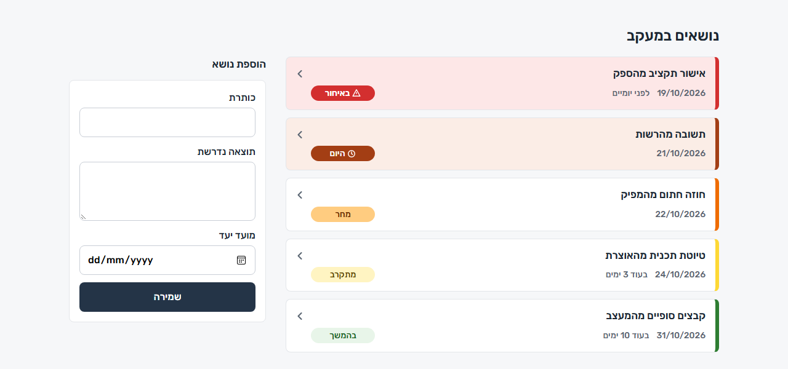 |
| פרטי נושא (עם היסטוריית עדכונים) |  | 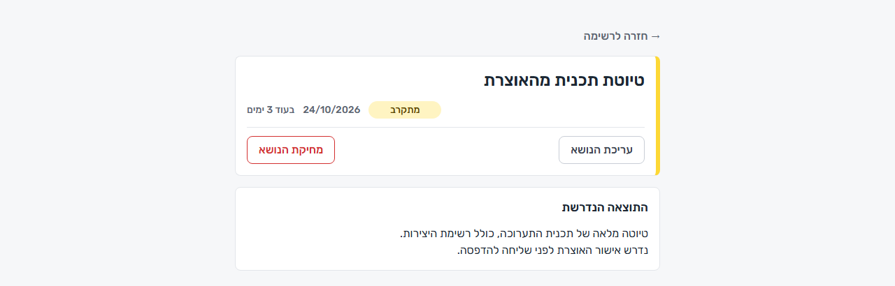 |
| עריכה | 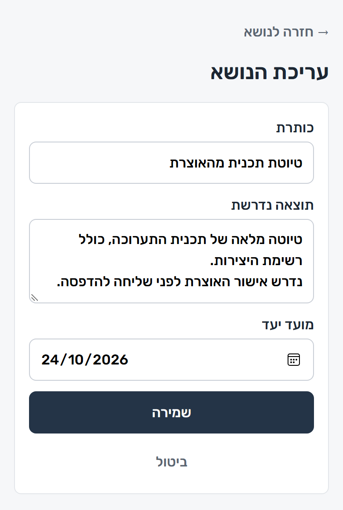 | 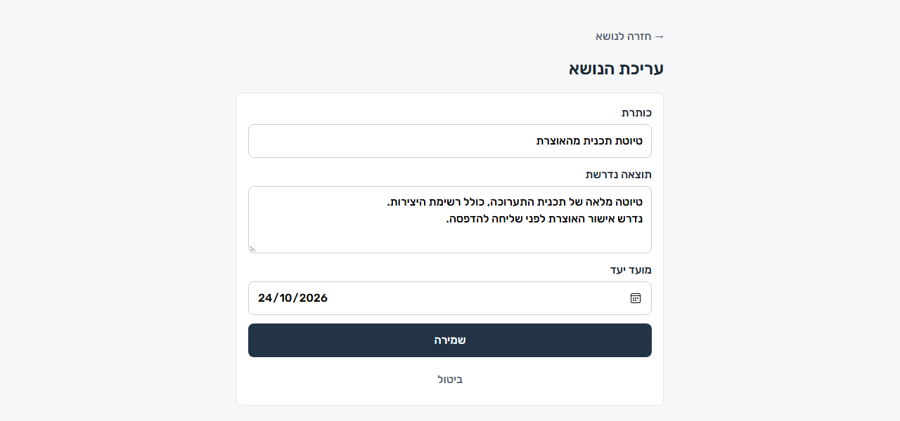 |
| אישור מחיקה | 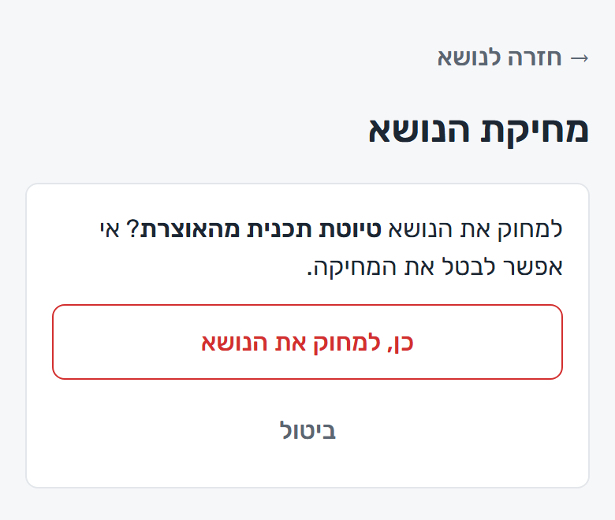 | 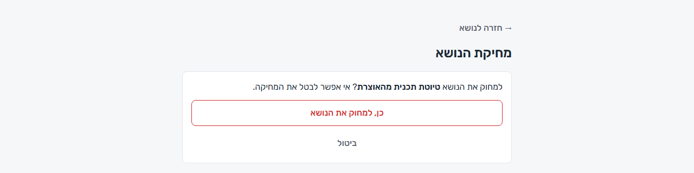 |

העיצוב הראשוני מסטיץ', שהיה נקודת המוצא. במימוש שיניתי כמה דברים בעקבות בדיקה בדפדפן: רקע צבעוני רק לכרטיסים הדחופים ("היום" ו"באיחור"), תגיות ברוחב אחיד, התווית "בהמשך" במקום "רחוק", ובמחשב טופס בעמודה בצד.

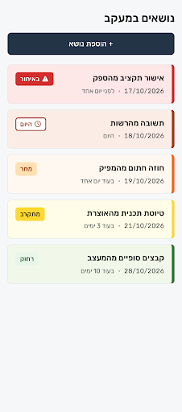

מסך פרטי הנושא בנייד כפי שאושר ב-Stitch (שלב 3). במימוש הצבעים הם של `style.css`, והכפתור "מחיקת הנושא" בלי מילוי:

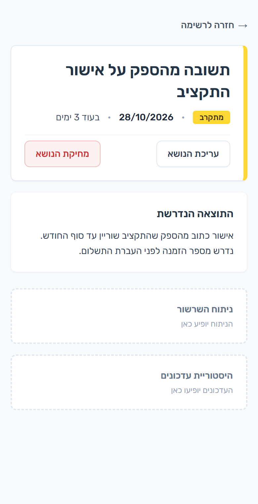

אזור היסטוריית העדכונים כפי שאושר (שלב 4, גרסה בלי תגית; נלקח מה-HTML של Stitch). במימוש יש הבדלים: "סיכום" מיד אחרי התאריך, תאריך ברירת המחדל הוא היום והטופס מקופל:

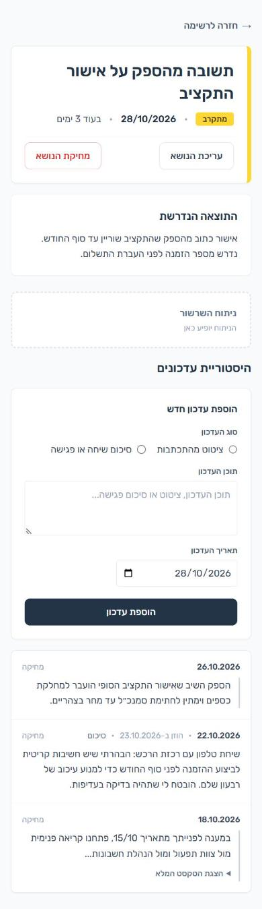

- ב-Stitch אושרו רק מסך הנייד של הרשימה, מסך הנייד של פרטי הנושא ואזור העדכונים שבו (נייד בלבד). מסכי המחשב ומצבי הקצה שנוצרו שם בשלב 2 לא אומתו, ודפי העריכה ואישור המחיקה נבנו ישר בקוד.
- ה-`designMd` בסטיץ' לא מסונכרן עם הקוד (גוון רקע לכל דרגה, צבע התגית של "מתקרב", תגית "היום" מלאה, כפתור מחיקה בלי מילוי). מסך חדש שייווצר שם עלול לא להתאים לאפליקציה.

## תהליך הפיתוח והכלים

- **חלוקת עבודה:** תכנון במצב התכנון של Claude Code עם Opus, ובשיחה נפרדת עם Claude, שגם סוקרת כל שינוי לפני מיזוג. ביצוע וכתיבת קוד ב-Claude Code עם Sonnet.
- **שלבים קטנים:** שלב אחד בכל פעם, לפי התוכנית. תוכנית לכל שינוי לא טריוויאלי, ואישור לפני ביצוע.
- **auto mode:** אחרי אישור תוכנית, Claude Code עובד ב-auto mode. פעולות שאי אפשר לבטל, שעולות כסף או שמשנות כללים עוצרות לאישור (פירוט ב-[`docs/auto-mode.md`](docs/auto-mode.md)).
- **"Grill me" לפני תכנון:** לפני תכנון של שלב, Claude שואל שאלה אחת בכל פעם, עד שכל ההחלטות ברורות (כלל 1 ב-CLAUDE.md).
- **בדיקות:** pytest מקצה לקצה, מקרי קצה ורגרסיה אחרי כל שלב, ותיקון כשלים לפני שממשיכים.
- **סקירת אבטחה:** אחרי כל שלב (הזרקה, קלט, סודות, חשיפת מידע). ממצאים מדווחים ומתוקנים רק באישור. הסקירה של שלב 3 מצאה שנתיבי המחיקה והעריכה פתוחים ל-CSRF, והדבר תוקן באותו PR (Flask-WTF).
- **`/security-review` בכל PR קוד:** לפני מיזוג של כל PR שמשנה קוד מריצים בענף את הפקודה `/security-review`, ורושמים בתיאור ה-PR מה נמצא ומה תוקן (כלל 25 ב-CLAUDE.md). סקירה לפי פרומפט משלימה אותה ולא מחליפה אותה.
- **CSP וכותרות אבטחה:** כל תגובה של האפליקציה נשלחת עם `Content-Security-Policy` (משאבים רק מהאתר עצמו, בלי סקריפט או עיצוב בתוך הדף), `X-Content-Type-Options: nosniff` ו-`Referrer-Policy: same-origin`. זו שכבת הגנה נוספת מפני XSS, לפני שפלט ה-AI מוצג במסך.
- **גיט:** ענף חדש לכל פיצ'ר, אף פעם לא commit ישיר ל-`main`, ו-commit אחרי כל פעולה שהושלמה.
- **אובסידיאן:** יומן עבודה בכספת, בתיקייה `dependency-followup`. `Stop` hook (`.claude/settings.json` ו-`.claude/hooks/log_task.py`) מוסיף בסוף כל סבב רשומה קצרה עם ענף, commit וסיכום. שגיאה ב-hook לא עוצרת את העבודה: היא נרשמת עם תאריך ושעה ופירוט השגיאה ב-`data/hook_errors.log` (לא נכנס ל-git), ומוצגת התרעה קצרה. רשומות מפורטות (החלטות, בעיות פתוחות, צעד הבא) נכתבות ביד.
- **Hook להרצת הבדיקות:** `Stop` hook נוסף (`.claude/hooks/run_tests.py`, רשום ב-`.claude/settings.json`) מריץ את כל בדיקות pytest בסוף כל סבב, אבל רק אם קבצי `py`, `html` או `css` השתנו מאז ההרצה הירוקה האחרונה. שינוי בתיעוד בלבד לא מריץ בדיקות. כשבדיקה נכשלת ה-hook חוסם את סיום הסבב ומחזיר את השגיאה, וצריך לתקן לפני שממשיכים.
- **Hook שחוסם את `.env`:** `PreToolUse` hook (`.claude/hooks/block_env.py`) מונע מ-Claude Code לקרוא את קובץ המפתחות.
- **הפרדה בהערכה:** Claude Code לא קורא את קובצי מפתח התשובות, ולא מריץ את ההשוואה הסופית, שמציגה אותם. כך מי שכותב את הפרומפט לא רואה את התשובות הנכונות.
- **עצירה והתרעה אחרי 3 כישלונות:** בכישלון השלישי ברצף ה-hook מפסיק לחסום ומתריע: צליל אזהרה שונה מהרגיל, חלונית Windows, הודעה בעברית ורשומה ביומן באובסידיאן. ההתרעה נורית פעם אחת, וריצה ירוקה מאפסת את הספירה. מצב ההרצה האחרונה והספירה נשמרים ב-`data/.last_tested` וב-`data/.test_failures` (לא עולים לגיט).
- **GitHub CLI (`gh`):** פתיחה ומיזוג של pull requests מהטרמינל.
- **Stitch MCP:** יצירת העיצוב ו-design system ישירות מ-Claude Code.
- **Obsidian MCP:** קריאה וכתיבה בכספת מתוך הסשן.
- סקיל שהשתמשתי בו: frontend-design.
