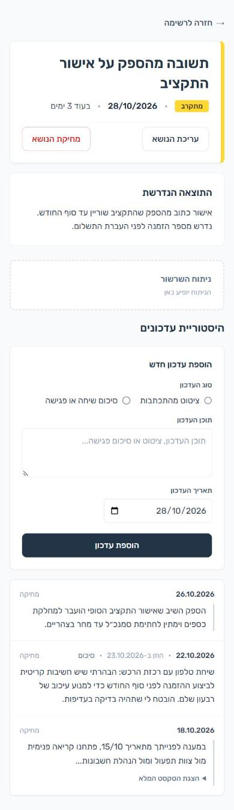

**עברית** | [English](README.en.md)

# Dependency Follow-up Assistant

כלי למעקב אחר נושאים שממתינים לגורמים אחרים (ספק, עמית, רשות). לכל נושא יש מועד יעד, והקוד מחשב ממנו כמה ימים נותרו ומסמן את הנושא באחת מחמש דרגות דחיפות. הממשק בעברית, מימין לשמאל.

הפרויקט בנוי בשלבים קטנים. כרגע מומשו **שלב 1 (שער 1)**: שמירת מועד והצגתו בצבע לפי הימים שנותרו, **שלב 2**: העיצוב מ-Stitch בתבניות ובקובץ ה-CSS, **שלב 3**: כמה נושאים עם תוצאה נדרשת, מסך פרטים, עריכה ומחיקה, ו**שלב 4**: היסטוריית עדכונים מתוארכת (התכתבות מודבקת או סיכום שיחה). האפיון ב-[`docs/spec.md`](docs/spec.md) והתוכנית המלאה ב-[`docs/plan.md`](docs/plan.md).

## דרגות הדחיפות

הספים מוגדרים פעם אחת, ב-`app/core/deadlines.py`. הימים הם ימים קלנדריים לפי תאריך בלבד, בשעון ישראל (`Asia/Jerusalem`).

| ימים שנותרו | דרגה | תווית |
|---|---|---|
| 6 ומעלה | `far` | בהמשך |
| 2–5 | `approaching` | מתקרב |
| 1 | `tomorrow` | מחר |
| 0 | `today` | היום |
| פחות מ-0 | `overdue` | באיחור |

## ארכיטקטורה

שלוש שכבות עם תלות חד-כיוונית, כך שאפשר להחליף את הממשק בלי לגעת בלוגיקה:

```
web  ──►  core      (לוגיקה טהורה, בלי Flask ובלי DB)
 │
 └─────►  storage   (SQLAlchemy Core, SQLite)
```

| רכיב | קבצים | תפקיד |
|---|---|---|
| `app/core/` | `deadlines.py` | חישוב ימים שנותרו (`days_remaining`), דרגת הדחיפות (`urgency_level`), הניסוח העברי (`days_text`) ו"היום" בשעון ישראל (`today_in_israel`), והתאריך בישראל של חותמת זמן שמורה (`israel_date`). פונקציות טהורות שמקבלות `today` כפרמטר, ולכן הבדיקות דטרמיניסטיות. |
| `app/core/` | `updates.py` | `excerpt`: הקטע הראשון של עדכון ארוך (עד 500 תווים או 8 שורות), שמוצג עם "הצגת הטקסט המלא". |
| `app/storage/` | `db.py`, `repository.py` | הגדרת הטבלאות `topics` (כותרת, תוצאה נדרשת, מועד) ו-`updates` (סוג, תוכן, תאריך העדכון, זמן ההזנה, וקישור לנושא עם מחיקה בשרשרת), ופונקציות `add_topic`, `list_topics`, `get_topic`, `update_topic`, `delete_topic`, `add_update`, `list_updates`, `get_update` ו-`delete_update`. החיבור נקבע ב-`DATABASE_URL` (ברירת מחדל `sqlite:///data/app.db`). כותרת או תוצאה ריקות נדחות, וכן כותרת ארוכה מ-200 תווים ותוצאה ארוכה מ-2000. התכתבות עד 200,000 תווים וסיכום עד 5,000. ב-SQLite מופעל `PRAGMA foreign_keys=ON` בכל חיבור, אחרת מחיקת נושא לא הייתה מוחקת את העדכונים שלו. |
| `app/web/` | `__init__.py`, `routes.py`, `templates/`, `static/` | אפליקציית Flask: `create_app()` (טוען `SECRET_KEY` מ-`.env` ומפעיל הגנת CSRF), נתיבי הרשימה, היצירה, הפרטים, העריכה והמחיקה, נתיבי העדכונים, ותבניות Jinja2 עם escaping אוטומטי. |
| `run.py` | | הפעלת השרת המקומי על `127.0.0.1:5000`. |
| `.env.example` | | תבנית להגדרות המקומיות (`SECRET_KEY`). הקובץ `.env` עצמו לא עולה לגיט. |
| `tests/` | | pytest לכל שלוש השכבות. |

הנתיבים של האפליקציה:

| נתיב | מה הוא עושה |
|---|---|
| `GET /` | רשימת הנושאים וטופס ההוספה |
| `POST /` | יצירת נושא |
| `GET /topics/<id>` | מסך פרטי הנושא |
| `GET /topics/<id>/edit`, `POST /topics/<id>/edit` | טופס עריכה, ושמירת השינויים |
| `GET /topics/<id>/delete` | דף אישור מחיקה (לא מוחק) |
| `POST /topics/<id>/delete` | מחיקה |
| `POST /topics/<id>/updates` | הוספת עדכון לנושא |
| `GET /topics/<id>/updates/<uid>/delete` | דף אישור מחיקת עדכון (לא מוחק) |
| `POST /topics/<id>/updates/<uid>/delete` | מחיקת עדכון |

כל בקשת POST דורשת טוקן CSRF, ובלעדיו התשובה היא 400 בדף שגיאה בעברית. מזהה נושא או עדכון שלא קיים, או עדכון של נושא אחר, מחזיר 404 בעברית. בקשה גדולה מ-4MB מחזירה 413 בעברית. אין עריכת עדכון, רק הוספה ומחיקה.

## זרימת הנתונים

**הוספת נושא (`POST /`):**
1. הטופס שולח כותרת, תוצאה נדרשת, תאריך וטוקן CSRF. בקשה בלי טוקן תקין (וכך גם בעריכה ובמחיקה) נדחית ב-400 עם דף שגיאה בעברית ("הטופס פג תוקף או שאינו תקין"), ושום דבר לא משתנה.
2. ה-route בודק את התאריך, ו-`add_topic` מסיר רווחים בקצוות ודוחה כותרת או תוצאה ריקות או ארוכות מדי.
3. הנושא נשמר בטבלת `topics`.
4. הדפדפן מופנה ל-`GET /` (redirect 303). בשגיאה חוזר הדף עם קוד 400 והודעה בעברית, וההזנה נשמרת.

**הצגת הרשימה (`GET /`):**
1. `list_topics` שולף את הנושאים ממוינים לפי מועד.
2. לכל נושא, `days_remaining` מחשב את הימים שנותרו מול `today_in_israel()`, ו-`urgency_level` קובע את הדרגה.
3. התבנית מציגה כותרת, תאריך, ניסוח הימים ותווית, עם מחלקת CSS `level-<דרגה>`. ב"היום" וב"מחר" ניסוח הימים לא מוצג, כי הוא חוזר על התווית (תצוגה בלבד). הצבע לא נושא את המידע לבדו, כי יש גם תווית טקסט. כל כרטיס לחיץ ומוביל למסך פרטי הנושא.

**פרטים, עריכה ומחיקה (`/topics/<id>`):**
1. מסך הפרטים מציג כותרת, דרגה, מועד והתוצאה הנדרשת. מזהה שלא קיים מחזיר 404 בעברית.
2. עריכה (`/edit`) עם אותה ולידציה כמו ביצירה, ובשגיאה הנושא לא משתנה.
3. מחיקה: `GET /delete` מציג דף אישור ולא מוחק. המחיקה עצמה רק ב-POST עם טוקן CSRF.

**היסטוריית עדכונים (`POST /topics/<id>/updates`):**
1. במסך הפרטים, הטופס המקופל מבקש סוג ("ציטוט מהתכתבות" או "סיכום שיחה או פגישה", בלי ברירת מחדל), תוכן ותאריך (ברירת מחדל: היום). הוא `novalidate`, והשרת בודק הכול.
2. השרת מסיר רווחים בקצוות, הופך `\r\n` ל-`\n` ודוחה סוג לא חוקי, תוכן ריק, תאריך לא תקין או עתידי, ותוכן ארוך מדי (בחריגה מוצגת הודעה עם האורך בפועל והגבול, ההזנה נשמרת ושום דבר לא נשמר).
3. כל עדכון נשמר כרשומה נפרדת (`updates`), ולא דורס אחרים. החדש מוצג למעלה.
4. התכתבות מזוהה בפס בצד, וסיכום במילה "סיכום" ליד התאריך. עדכון ארוך מוצג כקטע עם "הצגת הטקסט המלא" (בלי JavaScript), ובפתיחה מוצג רק הטקסט המלא עם "הצגה מקוצרת".
5. עדכון שהוזן בטעות אפשר למחוק אחרי דף אישור (POST בלבד, עם CSRF). מחיקת נושא מוחקת גם את העדכונים שלו.

הדחיפות מחושבת בקוד בלבד.

## התקנה

נבדק עם Python 3.14.7 על Windows 11. גרסאות אחרות של Python, וכן Linux ו-macOS, לא נבדקו.

התלויות ב-`requirements.txt`: `flask`, `sqlalchemy`, `flask-wtf` (הגנת CSRF), `python-dotenv` (טעינת `.env`), `tzdata` (ב-Windows אין מאגר אזורי זמן מובנה) ו-`pytest`.

**Windows (PowerShell):**

```
git clone https://github.com/Maya-Klein/dependency-followup.git
cd dependency-followup
python -m venv .venv
.venv\Scripts\python -m pip install -r requirements.txt
$key = .venv\Scripts\python -c "import secrets; print(secrets.token_hex(32))"
"SECRET_KEY=$key" | Set-Content -Path .env -Encoding ascii
```

שתי השורות האחרונות מייצרות מפתח אקראי וכותבות אותו ל-`.env`. `SECRET_KEY` נדרש להגנת CSRF, והאפליקציה לא עולה בלעדיו. `-Encoding ascii` מונע BOM, שעלול להפריע לקריאת הקובץ. אפשר גם להעתיק את `.env.example` ל-`.env` ולמלא את הערך ידנית. הקובץ `.env` לא עולה לגיט.

**Linux ו-macOS (לא נבדק):**

```
git clone https://github.com/Maya-Klein/dependency-followup.git
cd dependency-followup
python3 -m venv .venv
.venv/bin/python -m pip install -r requirements.txt
echo "SECRET_KEY=$(.venv/bin/python -c 'import secrets; print(secrets.token_hex(32))')" > .env
```

## הרצה

```
# Windows (PowerShell)
.venv\Scripts\python run.py

# Linux / macOS (לא נבדק)
.venv/bin/python run.py
```

האפליקציה זמינה ב-http://127.0.0.1:5000. קובץ ה-DB נשמר ב-`data/app.db` (לא עולה לגיט). אפשר לשנות אותו עם המשתנה `DATABASE_URL`.

## בדיקות

```
# Windows (PowerShell)
.venv\Scripts\python -m pytest

# Linux / macOS (לא נבדק)
.venv/bin/python -m pytest
```

הבדיקות מכסות את ערכי הקצה של הדרגות, מעברי חודש ושנה, אזור זמן סביב חצות, שמירה ושליפה מחיבור חדש, כותרת ותוצאה ריקות או ארוכות מדי, תאריך לא תקין, כותרת ותוצאה עם קוד HTML שמוצגים כטקסט בכל הדפים, יצירה, עריכה ומחיקה (כולל 404 ומחיקה ב-POST בלבד), הסתרת טקסט הימים ב"היום" וב"מחר", והגנת CSRF (בקשה בלי טוקן, עם טוקן שגוי או עם טוקן מ-session אחר נדחית ולא משנה כלום). בעדכונים: סדר ושיוך לנושא, גבולות האורך, סוג לא חוקי, תאריך עתידי, escaping, קיפול עדכון ארוך, מחיקה ו-CASCADE, ו-404 למזהה ענק.

הבדיקות לא צריכות קובץ `.env`: הן מגדירות לעצמן `SECRET_KEY`.

## מה האפליקציה עושה ומה לא

**עושה (שלבים 1–4):**
- שומרת נושא עם כותרת, תוצאה נדרשת ומועד יעד. כל השדות חובה.
- מחשבת בקוד כמה ימים נותרו (ימים קלנדריים, שעון ישראל) ומסמנת את הנושא באחת מחמש דרגות, עם צבע ותווית טקסט.
- מציגה את הרשימה ממוינת לפי מועד, עם קישור למסך פרטי הנושא. כותרת ותוצאה מוצגות כטקסט, גם אם הן כוללות HTML, ותוצאה רב-שורתית שומרת על השורות.
- מאפשרת לערוך נושא (כותרת, תוצאה ומועד) ולמחוק אותו, אחרי דף אישור. המחיקה בבקשת POST בלבד, וכל הטפסים מוגנים בטוקן CSRF (Flask-WTF).
- שומרת לכל נושא היסטוריית עדכונים מתוארכת: שרשור שהודבק כמו שהוא (עד 200,000 תווים) או סיכום של שיחה או פגישה בניסוח שלך (עד 5,000). עדכון לא נדרס ולא נערך, ואפשר למחוק עדכון שהוזן בטעות, אחרי אישור.

**לא עושה (עדיין):**
- אין סטטוס פתוח/סגור או אבן דרך.
- אין ניתוח AI של שרשורים. השרשורים נשמרים אבל לא מנותחים.
- אין התחברות, כמה משתמשים או פריסה לענן. משתמש יחיד על `127.0.0.1`.

## השוואה למאנדיי

- **הרעיון המרכזי:** המערכת מבחינה בין התקדמות ממשית לבין דיווח על התקדמות. "מטפלים בזה" הוא דיווח. אישור בכתב עם תאריך הוא התקדמות. הבדיקה נעשית ביחס לתוצאה נדרשת מוגדרת, עם ציטוטים מאומתים מההתכתבות.
- **מאנדיי (AI Risk Insights):** מזהה סיכונים מתוך נתונים ושיחות בתוך הכלי, ברמת צוותים ותיקי פרויקטים. כאן מנתחים התכתבות חיצונית שמודבקת למערכת, והכלי מיועד לאדם אחד שעוקב אחרי תלויות בגורמים חיצוניים.
- **מה מומש עד כה:** התוצאה הנדרשת והמועד, והדבקת שרשור או סיכום כהיסטוריית עדכונים (שלבים 1–4). ניתוח ה-AI, כולל ההבחנה בין דיווח להתקדמות ואימות הציטוטים, מתוכנן לשלבים 5–6 ועדיין לא קיים.
- **בסיס ההשוואה:** התיעוד של מאנדיי בלבד, ולא שימוש בפועל.

## מגבלות ידועות

- ימים נספרים לפי לוח שנה בלבד, בלי ימי עבודה, סופי שבוע או חגים.
- ספי הדרגות קבועים בקוד ואינם ניתנים להתאמה.
- עדכון לא נערך, רק נמחק. אין רישום של מחיקות, ולכן מחיקה היא סופית (ברשימת "בהמשך" בתוכנית).
- שלב 3 הוסיף עמודה (`required_outcome`) לטבלת `topics`. אם יש לך `data/app.db` מלפני שלב 3, צריך למחוק אותו. גם שינויי סכמה בשלבים הקרובים ידרשו זאת.
- `pip-audit` הורץ על `requirements.txt` ב-19.10.2026 וב-21.10.2026 (אחרי הוספת `flask-wtf` ו-`python-dotenv`), ובשתי הריצות לא נמצאו פרצות ידועות. כדאי להריץ אותו שוב כשמוסיפים תלויות.
- ב-Stitch אושרו רק מסך הנייד של הרשימה, מסך הנייד של פרטי הנושא ואזור העדכונים שבו (נייד בלבד). מסכי המחשב ומצבי הקצה שנוצרו שם בשלב 2 לא אומתו, ודפי העריכה ואישור המחיקה נבנו ישר בקוד.
- ה-`designMd` בסטיץ' לא מסונכרן עם הקוד (גוון רקע לכל דרגה, צבע התגית של "מתקרב", תגית "היום" מלאה, כפתור מחיקה בלי מילוי). מסך חדש שייווצר שם עלול לא להתאים לאפליקציה.

## הצעדים הבאים

לפי [`docs/plan.md`](docs/plan.md), שלב אחד בכל פעם:

1. **שלב 5:** ניתוח שרשור ב-AI, מבודד ובלי ממשק, עם אימות ציטוטים בקוד.
2. **שלב 6:** חיבור הניתוח לאפליקציה.
3. **שלב 7:** סטטוס פתוח/סגור ואבן דרך.
4. **שלב 8:** תרחישים סינתטיים, ושער 3.

בנוסף: שלב פריסה לשרת (Railway), שמיקומו ייקבע בהמשך.

הסדר שונה ב-21.10.2026 בעקבות משוב המרצה: רכיב AI הוא חובה, ולכן הוא הוקדם לפני הסטטוס והתרחישים.

רעיונות מחוץ ל-MVP מרוכזים בסעיף "בהמשך" ב-`docs/plan.md`.

## עיצוב

העיצוב נעשה ב-Stitch (פרויקט "מעקב תלויות – שער 1 (סופי)") ומומש בקוד בשלב 2, בתבניות ובקובץ ה-CSS בלבד (`app/web/templates/`, `app/web/static/style.css`), בלי לגעת ב-`storage/`. ב-`core/` שונו רק שתי מחרוזות (תווית "בהמשך" וניסוח "יום"). הפונט הוא Rubik, מאוחסן מקומית ב-`app/web/static/fonts/` (גרסה משתנה, תת-קבוצות עברית ולטינית, רישיון OFL) ולא נטען מ-Google Fonts, כך שהדף לא פונה לצד שלישי. ה-RTL מלא, הפינות 8px, ולכל נושא כרטיס עם פס צבע של 6px בצד ימין.

- **תגית בכל דרגה:** הצבע אינו האות היחיד. כל התגיות באותו רוחב, ועוצמת הצבע שלהן עולה ככל שהמועד מתקרב.
- **"היום" מול "באיחור":** "היום" בתגית מלאה בחום-כתום כהה עם אייקון שעון, ו"באיחור" בתגית אדומה מלאה עם אייקון אזהרה. רק שני אלה מקבלים רקע צבעוני לכרטיס. ב"היום" וב"מחר" אין טקסט ימים, כי הוא חוזר על התגית.
- **נייד:** עמודה אחת. הרשימה קודמת, והטופס נפתח מהכפתור "+ הוספת נושא" (`details/summary`, בלי JavaScript). אחרי שגיאה הטופס חוזר פתוח.
- **מחשב:** רשימה רחבה מימין, וטופס בעמודה בצד, עם הכותרת "הוספת נושא".
- **כרטיס לחיץ:** כל כרטיס ברשימה הוא קישור למסך הפרטים, עם חץ קטן בצד שמאל שמיושר לשורת הכותרת.
- **מסך הפרטים:** כרטיס כותרת עם פס צבע, תגית, מועד, והכפתורים "עריכת הנושא" ו"מחיקת הנושא" בשורה אחת בתחתיתו. "מחיקת הנושא" בלי מילוי: טקסט אדום ומסגרת אדומה דקה. מתחתיו כרטיס "התוצאה הנדרשת". הדף צר (40rem) גם במחשב. עיצוב הנייד שלו נעשה ב-Stitch ואושר (בתמונה למטה), והמימוש משתמש בצבעים של `style.css` ולא בצבעים של Stitch.
- **עריכה ואישור מחיקה:** נבנו בקוד באותו סגנון, בלי עיצוב נפרד ב-Stitch. המחיקה רק אחרי דף אישור.
- **היסטוריית עדכונים (שלב 4):** אזור במסך הפרטים, עוצב ב-Stitch (נייד בלבד) בשתי גרסאות לסימון סוג העדכון, ונבחרה גרסה בלי תגית. התכתבות מזוהה רק לפי פס בצד, וסיכום במילה "סיכום" באפור ליד התאריך. הטופס מקופל, ונסגר דרך "סגירה" או "ביטול". הודעות השגיאה בכל האפליקציה שקטות: טקסט כהה, פס אדום דק בצד ורקע בהיר מאוד.

צילומי מסך של האפליקציה הרצה, מתוך `docs/screenshots/` (Windows 11, נייד ברוחב 390 ומחשב ברוחב 1280, עם נתוני דוגמה; מסך פרטי הנושא עם ההיסטוריה צולם ב-Chrome ושאר המסכים ב-Edge):

| מסך | נייד | מחשב |
|---|---|---|
| רשימה וטופס הוספה |  |  |
| פרטי נושא (עם היסטוריית עדכונים) |  |  |
| עריכה |  |  |
| אישור מחיקה |  |  |

העיצוב הראשוני מסטיץ', שהיה נקודת המוצא. במימוש שיניתי כמה דברים בעקבות בדיקה בדפדפן: רקע צבעוני רק לכרטיסים הדחופים ("היום" ו"באיחור"), תגיות ברוחב אחיד, התווית "בהמשך" במקום "רחוק", ובמחשב טופס בעמודה בצד.


מסך פרטי הנושא בנייד כפי שאושר ב-Stitch (שלב 3). במימוש הצבעים הם של `style.css`, והכפתור "מחיקת הנושא" בלי מילוי:


אזור היסטוריית העדכונים כפי שאושר (שלב 4, גרסה בלי תגית; נלקח מה-HTML של Stitch). במימוש יש הבדלים: "סיכום" מיד אחרי התאריך, תאריך ברירת המחדל הוא היום והטופס מקופל:



## תהליך הפיתוח והכלים

- **חלוקת מודלים:** תכנון עם Opus וביצוע וכתיבת קוד עם Sonnet.
- **שלבים קטנים:** שלב אחד בכל פעם, לפי התוכנית. תוכנית לכל שינוי לא טריוויאלי, ואישור לפני ביצוע.
- **בדיקות:** pytest מקצה לקצה, מקרי קצה ורגרסיה אחרי כל שלב, ותיקון כשלים לפני שממשיכים.
- **סקירת אבטחה:** אחרי כל שלב (הזרקה, קלט, סודות, חשיפת מידע). ממצאים מדווחים ומתוקנים רק באישור. הסקירה של שלב 3 מצאה שנתיבי המחיקה והעריכה פתוחים ל-CSRF, והדבר תוקן באותו PR (Flask-WTF).
- **גיט:** ענף חדש לכל פיצ'ר, אף פעם לא commit ישיר ל-`main`, ו-commit אחרי כל פעולה שהושלמה.
- **אובסידיאן:** יומן עבודה בכספת, בתיקייה `dependency-followup`. `Stop` hook (`.claude/settings.json` ו-`.claude/hooks/log_task.py`) מוסיף בסוף כל סבב רשומה קצרה עם ענף, commit וסיכום. רשומות מפורטות (החלטות, בעיות פתוחות, צעד הבא) נכתבות ביד.
- **Hook להרצת הבדיקות:** `Stop` hook נוסף (`.claude/hooks/run_tests.py`, רשום ב-`.claude/settings.json`) מריץ את כל בדיקות pytest בסוף כל סבב, אבל רק אם קבצי `py`, `html` או `css` השתנו מאז ההרצה הירוקה האחרונה. שינוי בתיעוד בלבד לא מריץ בדיקות. כשבדיקה נכשלת ה-hook חוסם את סיום הסבב ומחזיר את השגיאה, וצריך לתקן לפני שממשיכים.
- **עצירה והתרעה אחרי 3 כישלונות:** בכישלון השלישי ברצף ה-hook מפסיק לחסום ומתריע: צליל אזהרה שונה מהרגיל, חלונית Windows, הודעה בעברית ורשומה ביומן באובסידיאן. ההתרעה נורית פעם אחת, וריצה ירוקה מאפסת את הספירה. מצב ההרצה האחרונה והספירה נשמרים ב-`data/.last_tested` וב-`data/.test_failures` (לא עולים לגיט).
- **GitHub CLI (`gh`):** פתיחה ומיזוג של pull requests מהטרמינל.
- **Stitch MCP:** יצירת העיצוב ו-design system ישירות מ-Claude Code.
- **Obsidian MCP:** קריאה וכתיבה בכספת מתוך הסשן.
- סקילים שהשתמשתי בהם: frontend-design, security-review.
